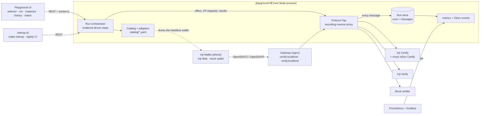

# Inji Interop Playground

Team **hoodcoders** · MOSIP Decode 2026 · Problem Statement 02 (Inji)

A web playground that tests whether a verifiable credential can be **issued** by one system, **held** by another and **verified** by a third, and shows every protocol message exchanged along the way.

Pick an issuer, a wallet and a verifier, choose a credential format, press **Run**, and watch a live issue → hold → present → verify cycle (OpenID4VCI + OpenID4VP). Every run ends with a pass/fail interoperability report.

| Role     | Starting implementation                   |
| -------- | ----------------------------------------- |
| Issuer   | Inji Certify                              |
| Wallet   | Inji Wallet (mobile), Inji Web (+ Mimoto) |
| Verifier | Inji Verify                               |

Supported credential formats include W3C VC JSON-LD (`ldp_vc`), SD-JWT VC (`vc+sd-jwt`
and `dc+sd-jwt`) and mDoc (`mso_mdoc`).

## Quick start (Docker)

You need Docker with Compose v2 (Docker Desktop, or Docker Engine on Linux), `git`, `make` and `curl`, and at least 4 GB of memory for Docker (the running stack uses about 1.6 GB). Node and pnpm are only needed to run the interop suite or to develop.

```sh
git clone https://github.com/GouravN97/hoodcoders_decode2026.git
cd hoodcoders_decode2026
make up
```

`make up` builds the playground images, starts Inji Certify, Inji Verify, the playground, the mock wallet and the mock verifier, and waits until every required service is healthy. The first start downloads about 3.5 GB of images and takes several minutes; later starts take a minute or two, mostly for Certify and Verify to boot. Without `make` (for example in PowerShell), run the same stack with Compose:

```sh
cd injistack
docker compose up -d --build
docker compose ps        # wait until certify and verify-service are running; then check http://localhost:8101/api/health
```

When it is up:

| What | Where |
| --- | --- |
| **Playground** | <http://localhost:8100> |
| Health of every service | <http://localhost:8101/api/health>, or `make health` (needs Node) |
| Inji Verify UI | <http://localhost:3000> |
| Inji Certify and Inji Verify, public addresses | <https://certify.localhost:8443>, <https://verify.localhost:8443> (local CA in `injistack/certs/local-ca.crt`) |

**First run.** Open the playground and choose **Inji Certify** → **Mock wallet** → **Inji Verify**. Pick **SD-JWT** (`vc+sd-jwt`) or **JSON-LD** (`ldp_vc`) and press **Run**. The run issues a real credential, presents it, and ends with **Valid** and a pass/fail report. Open the protocol inspector to see every message. Then try a **Tamper** (for example *Broken signature*, expected **Invalid**) or the **Expired credential** tamper (expected **Valid but expired**).

**More of the stack.** Each of these is `make up` plus a Compose profile:

| Command | Adds |
| --- | --- |
| `make up-mdoc` | Certify's mock mDoc issuer (`mso_mdoc` lanes with the mock wallet and mock verifier) |
| `make up-telemetry` | Prometheus and Grafana: the interoperability dashboard at <http://localhost:8106> |
| `make up-web` | Mimoto, eSignet and Inji Web (see [the Inji Web setup](injistack/README.md#esignet-and-the-wallet-profile)) |
| `make up-phone` | Cloudflare tunnels so Inji Wallet on a phone or emulator can reach the stack ([how to test](injistack/README.md#test-with-inji-wallet-on-an-android-emulator)) |

Run the headless interop suite against the running stack with `pnpm install && make interop` (30 lanes, about a minute; results in `out/interop/`). Six of them use MOSIP Collab's Inji Verify, see below.

**Stop.** `make down` stops everything and keeps saved runs. `docker compose down -v` in `injistack/` also deletes the database, the saved runs and the local certificates.

**If something is not up.** `make health` or <http://localhost:8101/api/health> names the service that is down, and `make logs S=certify` follows its logs. Certify and Verify need a minute or two after their containers start. The stack publishes ports 8100, 8101, 8104, 8105, 8443, 8080, 8090, 8091, 3000 and 5433, so stop anything else using them. For a database created before 26 October 2026, apply the [issuer DID update](injistack/README.md#upgrading-an-existing-database).

## MOSIP Collab sandbox

[MOSIP Collab](https://docs.inji.io/readme/try-it-out) is MOSIP's hosted copy of the Inji stack. You cannot deploy the playground into it, but the playground can use **Collab's Inji Verify as a verifier**: it is in the selector as **Inji Verify (MOSIP Collab)**. These are the Collab services, as checked on 26 October 2026:

| Service | Address | What it runs |
| --- | --- | --- |
| Inji Verify | <https://injiverify.collab.mosip.net> | Inji Verify with the 1.0 API: OpenID4VP 1.0 with DCQL (`/v1/verify/v2/vp-request`), client ID `decentralized_identifier:did:web:injiverify.collab.mosip.net:v1:verify`. **Usable from the playground** |
| Inji Certify (mock) | <https://injicertify-mock.collab.mosip.net> | `MockVerifiableCredential` (`ldp_vc`, also VCDM 2.0), `MockVerifiableCredential_SD_JWT` (`dc+sd-jwt`), `LandStatementCredential`; authorization code only (eSignet mock login) |
| Inji Web, Mimoto, eSignet | <https://injiweb.collab.mosip.net>, <https://api.collab.mosip.net>, <https://esignet.collab.mosip.net> | The reference wallet flow: Collab's issuers (Farmer, Land, Mosip ID, Mock mDL, …) behind a mock-identity login |

### Run a lane against Collab

1. `make up` (the machine needs internet access).
2. In the playground, choose **Inji Certify** → **Mock wallet** → **Inji Verify (MOSIP Collab)**, pick **SD-JWT** (`vc+sd-jwt`) and press **Run**. Every tamper works as with the local Verify.
3. Or run every Collab lane at once: `make interop MATRIX=matrices/collab.yaml`. The nightly suite includes them, and skips them when Collab is unreachable.

The local Certify issues the credential. The mock wallet then fetches Collab's signed request object, checks it against Collab's `did:web`, answers with a DCQL `vp_token`, and the playground reads Collab's verdict and each of its checks. The BFF's calls to Collab and the mock wallet's calls both pass through a Protocol Tap listener (`TAP_UPSTREAM_VERIFY_COLLAB`; the wallet is routed there with `WALLET_ROUTES`), so the inspector shows every message as for the local stack. The local Inji Verify gives the second opinion. Collab is never asked for one on other runs, so local credentials are only sent to Collab when you pick it.

**Results, 26 October 2026** (Certify 0.14.0 → mock wallet → Collab's Inji Verify; JSON-LD with the stack behind tunnels):

| Lane | Collab, `vc+sd-jwt` | Collab, `ldp_vc` | Inji Verify 0.18.2 (local) |
| --- | --- | --- | --- |
| Valid | **Valid**: signature, holder proof (nonce, audience, key binding) and validity all pass | **Valid**: same three checks | Valid |
| Broken signature, edited claim | **Invalid** | **Invalid** (signature check) | Invalid |
| Expired copy | **Valid but expired** | **Valid but expired** | Valid but expired |
| Wrong credential type | **Refused** at `direct_post`, HTTP 400: `vct claim does not match any of the vct_values in the DCQL query` | **Refused**, HTTP 400: `credential type values do not satisfy any of the type_values options` | **Accepted** (gap 1) |
| Replayed presentation | **Refused** at `direct_post`, HTTP 400: `Nonce validation failed` | **Refused**, HTTP 400: `Nonce validation failed` | **Accepted** for SD-JWT (gap 2) |

So gaps 1 and 2 are fixed in the 1.0 API that Collab runs. A refusal at submission is reported as *Rejected*, which passes with a warning when the run expected Invalid.

**JSON-LD (`ldp_vc`) needs the tunnels.** Collab checks a JSON-LD credential's signature by resolving the issuer's `did:web` over the internet. On a localhost stack that is `did:web:certify.localhost`, which fails (`certify.localhost: Name has no usable address`), so the run is Invalid although the holder proof passes. Behind tunnels the issuer DID is the tunnel's public hostname, and every JSON-LD lane above passes. Start them with `make up-phone` (or `PROFILES="mdoc telemetry" ./scripts/tunnel-up.sh` in `injistack/` without the wallet profile), and go back with `make tunnel-down`. SD-JWT works without tunnels, because Collab checks it with the `x5c` certificate in the credential.

**Other wallets.** Inji Wallet on a phone has not been tried against Collab: its catalog entry declares draft 23 with Presentation Exchange, so the selector warns. It would also need the stack behind tunnels to receive the local Certify's offer. Collab's own issuers use the authorization-code flow, which the playground cannot start yet; use Inji's [Try it out](https://docs.inji.io/readme/try-it-out) guide to download their credentials into Inji Web or Inji Wallet.

Offline, Collab's health check fails: the verifier shows as offline in the selector and the suite skips its lanes. Credentials only go to Collab in runs that pick it.

## Status

Live runs work end to end: [`injistack/`](injistack) starts Inji Certify, Inji Verify, the playground UI, the BFF with its Protocol Tap and a headless mock wallet with Docker Compose. A run issues a real credential from Certify (pre-authorized code), the wallet presents it to Inji Verify over OpenID4VP, every message passes through the tap and shows in the inspector, and the run ends with a pass/fail report.

| Lane | State |
| --- | --- |
| Certify → mock wallet → Inji Verify, SD-JWT (`vc+sd-jwt`) | Valid runs pass, in the browser and over the API |
| Certify → mock wallet → Inji Verify, JSON-LD (`ldp_vc`) | Valid runs pass against the real stack (checked 25 October 2026; the JSON-LD contexts need internet access) |
| Certify → Inji Wallet (Android app, `v1.0.0-alpha.1`) → Inji Verify | SD-JWT (`vc+sd-jwt`) verifies **VALID** on an emulator through Cloudflare quick tunnels ([how to test](injistack/README.md#test-with-inji-wallet-on-an-android-emulator)). JSON-LD (`ldp_vc`) also verifies **VALID** (24 October 2026, runs `2e946c94` and `33d84bb6`) since Certify's Farmer template issues a bare `did:jwk` subject id; with a `…#0` subject id the wallet's holder became `…#0#0` and Verify rejected it (gap 4). |
| Hovi Playground → Inji Wallet | Selectable for Issue-only PID tests in `dc+sd-jwt` and `mso_mdoc`; live offer creation verified, wallet acceptance still needs a phone scan |
| Animo Playground → Paradym → Inji Verify (MOSIP Collab) | **Valid**, end to end (11 November 2026, physical phone): an Animo Tax-ID in `dc+sd-jwt`, held in Paradym (Animo's wallet app) and presented to Collab's Inji Verify 1.0 over OpenID4VP 1.0 with DCQL. Issuer, wallet and verifier come from three different parties; only the verifier is Inji ([results](docs/external-credential-interoperability-results.md#animo--paradym--inji-verify-mosip-collab)) |
| Animo Playground → Inji Wallet | Selectable for Issue-only tests in `dc+sd-jwt` and `mso_mdoc` (every credential Animo publishes); live offer creation verified, Inji Wallet acceptance still needs a phone scan |
| Inji Web | Mimoto, Inji Web and the eSignet login work once the keystore and `wallet-demo` client are set up ([`register-wallet-client.sh`](injistack/scripts/register-wallet-client.sh)); the download still fails because eSignet rejects the client assertion with `invalid_client` ([details and what was ruled out](injistack/README.md#current-local-web-wallet-limitation)) |
| Valid-but-expired | `FarmerCredentialExpired` (ldp_vc) and `FarmerCredentialSdJwtExpired` (vc+sd-jwt) are signed with validity in the past; Inji Verify reports **EXPIRED** (also the T-EXPIRED tamper) |
| History and matrix | `/history` with filters by module version, format, outcome, mode, tamper and date; matrix exported as Markdown. Checked against the real stack's saved runs and the mocks |
| Sequence diagram | Live in the inspector for every run; checked against the real stack (SD-JWT, mock wallet) and the in-browser mocks, in both themes |
| Certify → mock wallet → **Mock verifier** (non-Inji), SD-JWT (`vc+sd-jwt`) | Run live on 25 October 2026: valid runs pass with all ten checks passing on a real Certify 0.14.0 credential, and every tamper is caught at its own check (signature, disclosures, requested type, holder-binding nonce, expiry). `ldp_vc` is not checked by this verifier. **Inji Wallet (emulator) → mock verifier, SD-JWT: VALID** (the wallet sends `vp_token` as a JSON-encoded string, which the mock verifier accepts with a warning) |
| **mDoc** (`mso_mdoc`): Certify mock mDoc → mock wallet → mock verifier | Run live on 25 October 2026 (`docker compose --profile mdoc`): a second Certify 0.14.0 in its own mock mDoc mode issues an ISO mDL by pre-authorized offer; the mock wallet presents it as a DeviceResponse and the mock verifier checks the COSE issuer signature, trust, element digests, the device signature over the OpenID4VP session transcript, and validity. Valid passes; broken signature, edited element, wrong docType and replayed nonce are caught. Issuing it to Inji Wallet on the emulator fails (gap 12). Inji Verify 0.18.2 refuses an mDoc presentation (`400 INVALID_VP_TOKEN`), so the selector explains that instead of hiding the format ([results](docs/external-credential-interoperability-results.md#mdoc-certify-mock-mdoc)) |
| Same-device link | On a phone-sized or touch screen the delivery panel shows **Open in wallet** for `openid4vp://` and `openid-credential-offer://` links, with the QR code behind a toggle. Checked on the Android emulator (25 October 2026): from emulator Chrome, the button opened Inji Wallet `1.0.0-alpha.1` with the offer. An emulator result, not a physical phone; the rest of that run was not completed (it needs the tunnels) |
| Digital Credentials API | The mock verifier accepts an unsigned OpenID4VP 1.0 / DCQL request over `navigator.credentials.get`. **No wallet in the catalog advertises it** (Inji Wallet `1.0.0-alpha.1` has no Credential Manager provider), so it is tested only with a stubbed browser API in the UI, and live on the server side with a script standing in for the browser's wallet: a real Certify SD-JWT bound to the page origin is Valid, one bound to another origin fails holder binding |
| Second opinion (`VER-002`) | After each verification the other verifier checks the presented credential on its own. Inji Verify and the mock verifier agreed on every comparable live run (valid, broken signature, edited claim, expired) |
| Interop suite and nightly CI | `make interop` runs [`matrices/nightly.yaml`](matrices/nightly.yaml) through the playground with [`interop-cli`](packages/interop-cli/README.md): 30 headless lanes across Inji Verify (local 0.18.2 and MOSIP Collab), the mock verifier and mDoc. On 26 October 2026: 27 pass and 3 known gaps (gaps 1 and 2, local Inji Verify only) ([summary](reports/interop-suite.md)). A nightly GitHub Actions workflow runs the same suite and publishes the matrix |
| Telemetry | `make up-telemetry` adds Prometheus and a provisioned Grafana dashboard (<http://localhost:8106>): success rate per issuer × wallet × verifier × format and version, the share of negative tests caught, mean step and message latency, and protocol errors. Each finished run is also written as an event in the Sunbird telemetry envelope Inji Wallet sends to Obsrv, and posted to Obsrv when `OBSRV_INGEST_URL` is set. Checked 26 October 2026 against the local stack's 210 saved runs |
| **MOSIP Collab Inji Verify** (OpenID4VP 1.0, DCQL) | Certify → mock wallet → Collab's Inji Verify, run live on 26 October 2026 for `vc+sd-jwt` and for `ldp_vc` (behind tunnels): valid passes, and every tamper is caught, including the wrong type and the replay that Inji Verify 0.18.2 accepts (gaps 1 and 2) ([MOSIP Collab sandbox](#mosip-collab-sandbox)) |
| Replay & tamper (mock wallet → Inji Verify 0.18.2) | Run live for both formats. Broken signature and edited claim are rejected (**INVALID**). Inji Verify **accepts** a wrong credential type for both formats, and, for SD-JWT only, a replayed `vp_token` or one bound to an old nonce ([results](docs/external-credential-interoperability-results.md#replay-and-tamper-runs-against-inji-verify-0182)) |

The reproducible passing demonstrations are SD-JWT and JSON-LD with the mock
wallet (including tamper runs) and both formats with the mobile Wallet.

The UI also still runs entirely against in-browser mocks with `pnpm dev`.

### Run modes

Issuing and verifying are separate parties, so each half can run on its own. Pick one under **What to run** in the run settings:

| Mode                  | Phases                                                               | Talks to                 |
| --------------------- | -------------------------------------------------------------------- | ------------------------ |
| Full cycle            | issue → hold → present → verify                                      | issuer, wallet, verifier |
| Issue only            | issue → hold; passes once the credential is in the wallet            | issuer, wallet           |
| Present & verify only | hold → present → verify, using a credential the wallet already holds | wallet, verifier         |

For present-only runs the mock wallet lists what earlier runs stored in it, so you can pick a credential (it forgets them when its container restarts). With Inji Wallet on a phone or Inji Web, you confirm on the run screen that the credential is already in the wallet. Present-only is the easiest way to test the verifier while the issuer is down, or to present an already-expired credential for **Valid-but-expired**.

### Replay and tamper

With the **Mock wallet**, the run settings offer a **Tamper** picker: a deliberate negative test that checks whether the verifier rejects a broken presentation (plan §13). Picking one sets the expected result; the expected result otherwise defaults to **Valid** and is not remembered between visits.

| Tamper | What is broken | Expected |
| --- | --- | --- |
| `T-SIG-FLIP` | One character of the issuer's signature | Invalid |
| `T-CLAIM-EDIT` | One claim value after issuance (a disclosure for SD-JWT) | Invalid |
| `T-WRONG-TYPE` | The verifier asks for a type the wallet does not hold; the wallet presents its credential anyway | Invalid |
| `T-NONCE-REPLAY` | The `vp_token` of an earlier, accepted run is resubmitted, or a new one is signed over that run's nonce | Invalid |
| `T-EXPIRED` | Certify issues the expired copy of the credential (`FarmerCredential*Expired`) | Valid but expired |

The inspector marks the message that carried the tampered payload and shows a before/after view, and the result card and report say whether the verifier caught the tamper. A tamper refused with another status than expected (for example Rejected at `direct_post` instead of Invalid) passes with a warning; one the verifier accepts fails the run.

### Mock verifier and second opinion

**Mock verifier** in the Verifier column is the playground's own OpenID4VP draft-23 verifier ([`apps/mock-verifier`](apps/mock-verifier/README.md)), so a run can end at a party that is not Inji. It speaks the same dialect Inji Verify 0.18.x does (Presentation Exchange, `direct_post`, a signed request object by reference, a `did:web` client ID) and is published as `/mock-verifier/…` on the Verify host, behind the Protocol Tap. It checks SD-JWT VC (`vc+sd-jwt` and `dc+sd-jwt`) only.

Its result lists every check it made, in order: response shape, state, presentation submission, requested credential (format and `vct`), SD-JWT format, issuer signature, issuer trust, disclosures, holder binding (key-binding JWT `nonce`, `aud`, `sd_hash`, `cnf`) and validity period. The result card shows them, and the failing one names what went wrong.

**Second opinion (`VER-002`).** After the run's verifier answers, the playground asks the other verifier about the same presented credential, on its own: Inji Verify's `/v1/verify/vc-verification` (with `Content-Type: application/vc+sd-jwt`) or the mock verifier's `api/verify-credential`. The finding is INFO when they agree and WARN when they disagree. A credential-only check cannot see presentation problems (wrong requested type, replayed or stale nonce), so for those runs the two verdicts are shown but not compared. The call goes through the tap; the sequence diagram shows it as a note, because the other verifier has no lane in the run.

### mDoc

**Inji Certify (mock mDoc)** is a second Certify container from the same pinned image, in the mode upstream's `certify-mock-mdl.properties` describes (`plugin-mode=VCIssuance`, `MDocMockVCIssuancePlugin`). That mode is a global switch, so it runs next to the Farmer Certify with its own database and a throwaway issuer key made at start-up, and is published as `/mdoc/…` on the Certify host. Start it with `docker compose --profile mdoc up -d` in `injistack/`. It issues an ISO 18013-5 mobile driving licence (`org.iso.18013.5.1.mDL`).

- **Inspector:** mDoc credentials and DeviceResponse `vp_token`s are decoded (CBOR/COSE): document type, each element with its digest checked against the MSO, validity, device key and issuer certificate. Differences from ISO 18013-5 seen in the credential are listed (for Certify: the `{docType, issuerSigned}` wrapper and a `driving_privileges` string).
- **Mock wallet** stores the mDoc and presents it as a DeviceResponse, disclosing only the requested elements and signing with its device key over the ISO 18013-7 Annex B session transcript (with `direct_post` there is no JWE, so the wallet's mdoc nonce is the empty string on both sides).
- **Mock verifier** checks it stage by stage (see [its README](apps/mock-verifier/README.md)); it trusts the certificate the `mdoc` profile generated.
- **Inji Verify 0.18.2** does not verify `mso_mdoc`. With Inji Verify selected, `mso_mdoc` stays selectable and the prediction says: run Issue only, or choose Mock verifier.

### Same-device and Digital Credentials API

**Same device.** When the playground is opened on a phone (narrow or touch screen), an offer or presentation request is shown as an **Open in wallet** button instead of a QR code (**Show QR code instead** brings the QR back). Inji Wallet registers both `openid-credential-offer://` and `openid4vp://`, so the link opens it.

**Digital Credentials API.** With **Mock verifier**, **How to present** offers **Digital Credentials API**. The run then asks the verifier for an unsigned OpenID4VP 1.0 request with a DCQL query, and the run page shows **Request with browser wallet**, which calls `navigator.credentials.get({ digital: … })` on the click. What the browser returns (or the error it throws) goes to `POST /api/runs/:id/dc-api-response`; the BFF relays it to the verifier as the wallet's message, and records the browser's origin, user agent and any error in the run's labels. The presentation must be bound to the page origin (`aud` = `origin:<origin>`). The selected wallet is not contacted, and the prediction says that no wallet in the catalog advertises the API. Browsers without the API get an explanation instead of the button.

### Sequence diagram

In the protocol inspector, **Sequence** shows the run's messages as an animated Mermaid sequence diagram that grows as the run goes; clicking an arrow opens that message underneath. **OpenID4VP** shows the presentation between the verifier, the wallet and the wallet's OpenID4VP library; **Full run** adds issuance.

- Solid arrows were captured by the Protocol Tap (or handed out by the playground as a QR code or link).
- Dashed arrows were **not** captured: the wallet's calls into its own library, and the token and credential requests a phone sends straight to an external issuer such as Hovi or Animo, which the run only knows from the holder's confirmation.
- A tamper shows as a note on the library lane and a red arrow.

The same diagram (full run) is in the Markdown report, and `GET /api/runs/:id/sequence?view=openid4vp|full` returns its Mermaid source.

### History and interoperability matrix

**History** in the sidebar lists every saved run (they survive restarts in the `playground-data` volume). You can filter by issuer, wallet and verifier and their versions, format, run mode, verifier result, verdict, tamper and date. The filters are kept in the URL, so a filtered view can be shared. Each run records the catalog versions it ran against when it was created, so a module upgrade does not rewrite old results.

The **Matrix** tab is the interoperability matrix deliverable: the latest run of each issuer × wallet × verifier × format, with versions, so an upgrade starts a new row. Negative tests (tampers, runs expecting Invalid or Expired) are left out unless included, so each cell answers "does the normal path work". **Export Markdown** downloads it with a link to each run; the API serves the same data at `GET /api/matrix` and `GET /api/matrix.md` (`?includeNegative=true`). `GET /api/runs` takes the same filters as query parameters.

With `pnpm dev` the history starts with a few runs marked **sample**, generated in the browser so the page is not empty; they are labelled everywhere and are not results.

### Interop suite and nightly CI

`make interop` runs the playground as a test suite: [`interop-cli`](packages/interop-cli/README.md) reads a matrix file ([`matrices/nightly.yaml`](matrices/nightly.yaml), [`matrices/demo.yaml`](matrices/demo.yaml)), starts one run per issuer → wallet → verifier × format lane through the BFF, and writes a Markdown summary, JUnit XML and every run report to `out/interop/`. Suite runs are ordinary runs, so they show in History and the matrix with their protocol messages. A lane can name a documented gap (`knownGap`): it is reported but does not fail the suite, and if it starts passing it is flagged so the gap can be closed.

[`.github/workflows/nightly-interop.yml`](.github/workflows/nightly-interop.yml) runs it every night: `make up PROFILES=mdoc`, `make interop`, then the summary as the job summary, the JUnit report, the matrix and the stack logs as an artifact, and on `main` the summary and matrix pushed to the `interop-reports` branch. [`.github/workflows/ci.yml`](.github/workflows/ci.yml) runs typecheck, lint and unit tests on every pull request. The latest local results are in [`reports/`](reports/README.md).

### Telemetry

`make up-telemetry` (or `PROFILES=telemetry` with any `make up` target) adds Prometheus (<http://localhost:8107>) and Grafana (<http://localhost:8106>, opens on the **Inji interoperability** dashboard). The BFF serves `GET /metrics` in the Prometheus text format, computed from every saved run on each scrape, so the dashboard covers the whole history and survives restarts:

| Metric | Labels | What it is |
| --- | --- | --- |
| `interop_runs`, `interop_runs_passed` | issuer, wallet, verifier and their versions, format, mode, verdict, `negative` | Finished runs, and those that passed. `negative="true"` marks tampers and runs that expect Invalid or Expired |
| `interop_run_duration_seconds_sum` / `_count` | as above | Run duration, creation to report |
| `interop_step_duration_seconds_sum` / `_count` | phase, step, status, format | Duration of each run step (offer, token, credential, request, response, result) |
| `interop_exchange_latency_seconds_sum` / `_count` | component, step | Latency of each protocol message through the Protocol Tap |
| `interop_exchange_errors` | component, step, status | Messages answered with HTTP 4xx/5xx or not at all |

**Obsrv.** Inji Wallet reports telemetry to an Obsrv host, which stores it in Druid. The BFF writes each finished run as one `INTEROP_RUN` event in the same Sunbird telemetry v3 envelope (`eid`, `ets`, `mid`, `actor`, `context.pdata`/`cdata`, `object`, `edata` with the participants, versions, format, verdict, step durations and error). The events go to `/data/telemetry/interop-runs-<date>.jsonl` in the `playground-data` volume (a Druid batch-ingestion source). When `OBSRV_INGEST_URL` is set in `injistack/.env` (an Obsrv dataset endpoint, `…/data/v1/in/<dataset>`), each event is also posted there; `OBSRV_AUTHORIZATION` is sent as the `Authorization` header. The plan's OpenTelemetry traces (plan §16.3) are not implemented: the Protocol Tap already records every message with its timing per run.

### Run Animo → Paradym → Inji Verify end to end

Paradym is Animo's wallet app (OpenID4VCI 1.0, OpenID4VP 1.0 with DCQL, `dc+sd-jwt`). Install it on a phone; the phone needs internet, not tunnels, because Animo and Collab are public.

1. Start the live Compose stack and open <http://localhost:8100>.
2. Issuer **Animo Playground**, wallet **Paradym (mobile)**, verifier **Inji Verify (MOSIP Collab)**.
3. Under **What to run**, choose **Full cycle**; format `dc+sd-jwt`; credential **Bundeszentralamt fur Steuern · Tax-ID — SD-JWT VC**. Press **Run**.
4. Scan the offer QR with Paradym and accept the card, then press **I can see the credential in my wallet**.
5. Scan the presentation request QR with Paradym and approve sharing. The run ends with Collab's verdict.

If Paradym already holds the Tax-ID, **Present & verify only** skips the offer in step 4 and goes straight to the request.

Use `dc+sd-jwt`, not `mso_mdoc`: Collab's adapter does not request mDoc, and the mock verifier's draft-23 requests are not readable by Paradym (`presentation information could not be extracted`). Only credentials whose type the adapter knows can be presented (`ANIMO_KNOWN_TYPES` in [`external-playgrounds.ts`](apps/playground-bff/src/adapters/external-playgrounds.ts), plus PIDs): a request must name the exact `vct`, which Animo's issuer list does not publish.

### Test Hovi or Animo issuance in Inji Wallet

1. Start the live Compose stack and open <http://localhost:8100>.
2. Choose **Hovi Playground** or **Animo Playground** as issuer.
3. Choose **Inji Wallet (mobile)** as wallet and any verifier (Issue only does not contact it).
4. Under **What to run**, choose **Issue only**.
5. Choose `dc+sd-jwt` or `mso_mdoc`, select the PID credential and press **Run**.
6. In Inji Wallet, tap **+ → Scan QR code**, scan the offer and accept it.
7. Once the credential is visible, press **I can see the credential in my wallet** on the run page.

The phone communicates with these public issuers directly, outside the local Protocol Tap. The run
therefore records the offer and the holder's explicit confirmation, and labels the inferred token
and credential steps as manual evidence. A successful issue-only run is reported as **Pass with
warnings** so it does not pretend that the unobserved third-party traffic was captured. Format or
OpenID4VCI-profile mismatches remain selectable on purpose: the compatibility panel predicts the
risk, while the run lets the team test whether the wallet actually accepts the offer.

## Architecture



- **Protocol Tap.** The gateway sends every protocol request for Certify, Verify and the mock verifier through a recording reverse proxy in the BFF. The proxy forwards each request unchanged, files it under its run by following identifiers (offer id → pre-authorized code → access token; request id → `state` → transaction id), and masks secrets in what it stores. The modules' own public URLs point at the gateway, so no response is rewritten. If the BFF is down, nginx falls back to the services directly. Details: [`PROTOCOL_TAP.md`](apps/playground-bff/PROTOCOL_TAP.md).
- **Adapters.** Each implementation is one YAML file in [`catalog/`](catalog) naming an adapter class that implements the issuer, wallet or verifier interface. The orchestrator only knows those interfaces, so adding a product is a YAML file and at most one class: see [Adding an implementation](docs/adding-an-implementation.md).
- **Evidence-driven runs.** A run is a fixed list of steps (offer → token → credential → held → request → response → result). Each step completes on evidence: an adapter call, a message seen by the tap, or the holder's confirmation for a phone. Every run ends with the expected and observed result, a verdict and a report.
- **Checks beyond the verifier.** The tamper mode (mock wallet hooks), the second opinion from the other verifier (`VER-002`), and the mock verifier's per-stage checks show *why* a presentation passed or failed, not only Inji Verify's answer.
- **One Compose stack.** [`injistack/`](injistack) pins every image: Certify 0.14.0, Verify 0.18.2, and Mimoto, eSignet and Inji Web in their own profiles. `make up` starts it and waits until it is healthy.

## Getting started

Needs Node 20+ and pnpm.

```sh
pnpm install
pnpm dev          # playground UI on http://localhost:5173, API served by mocks
pnpm test         # unit tests (Vitest)
pnpm e2e          # browser tests against the mocks (Playwright; run `pnpm exec playwright install chromium` once)
```

For live runs, one command starts the whole stack (Docker with Compose v2; the first start pulls about 3.5 GB):

```sh
make up           # Inji Certify, Inji Verify, the playground, mock wallet and mock verifier; waits until healthy
make up-mdoc      # the same, plus Certify's mock mDoc issuer
make up-phone     # the same, behind Cloudflare tunnels, for Inji Wallet on a phone or emulator
make up-telemetry # the same, plus Prometheus and Grafana (http://localhost:8106)
make health       # what is up
make down         # stop (saved runs are kept)
make help         # every target
```

Then open <http://localhost:8100>. The targets wrap `docker compose` in [`injistack/`](injistack/README.md), which still works on its own. With the stack up, `make e2e E2E_LIVE=1` runs the browser tests against it.

| Path                                         | What it is                                                                                                                                  |
| -------------------------------------------- | ------------------------------------------------------------------------------------------------------------------------------------------- |
| [`apps/playground-ui`](apps/playground-ui)   | Vite + React UI ([details](apps/playground-ui/README.md))                                                                                   |
| [`apps/playground-bff`](apps/playground-bff) | BFF: catalog, run orchestration, reports, live run events (socket.io) and the Protocol Tap ([details](apps/playground-bff/PROTOCOL_TAP.md)) |
| [`apps/mock-wallet`](apps/mock-wallet)       | Headless wallet (OpenID4VCI + OpenID4VP) for runs without a phone, with tamper switches ([details](apps/mock-wallet/README.md))             |
| [`apps/mock-verifier`](apps/mock-verifier)   | Non-Inji OpenID4VP draft-23 verifier that reports every check it makes ([details](apps/mock-verifier/README.md))                           |
| [`packages/protocol-core`](packages/protocol-core) | SD-JWT VC verification, `did:web` / `did:jwk` resolution and Presentation Exchange matching, shared by the mock wallet and mock verifier |
| [`injistack/`](injistack)                    | Docker Compose sandbox with the Inji stack and the playground ([details](injistack/README.md))                                              |
| [`packages/interop-cli`](packages/interop-cli) | Runs a matrix of lanes through the BFF as a test suite; Markdown, JUnit and JSON results ([details](packages/interop-cli/README.md)) |
| [`matrices/`](matrices)                      | Lane matrices for `make interop`: `nightly.yaml` (every headless lane), `demo.yaml`                                                         |
| [`packages/shared`](packages/shared)         | Domain types, zod schemas, REST and WebSocket contracts shared with the BFF                                                                 |
| [`catalog/`](catalog)                        | One YAML file per issuer / wallet / verifier; adding a product = adding a file                                                              |

## Docs

- [Mandatory tasks explained](docs/mandatory-tasks.md) — what we are building, task by task, in plain language
- [Implementation plan](docs/implementation-plan.md) — architecture, components, flows, infrastructure and schedule
- [Adding an implementation](docs/adding-an-implementation.md) — a new issuer, wallet or verifier: catalog YAML, adapter, Protocol Tap
- [API reference](docs/api.md) — every API the playground creates (BFF, realtime events, Protocol Tap, mock wallet, mock verifier) and uses (Certify, Verify, Collab, Mimoto, Hovi, Animo, Obsrv): endpoints, request and response formats, authentication, examples
- [Interoperability gaps](docs/gaps/README.md) — every gap found, what is already known upstream, and issue drafts to file
- [Reports](reports/README.md) — the nightly interop suite and the interoperability matrix from a live run

## License

[Mozilla Public License 2.0](LICENSE)

## Interoperability gaps found

Gaps found while running the playground against the pinned stack (Inji Certify `0.14.0`, Inji Verify `0.18.2`, Inji Wallet `1.0.0-alpha.1`, Mimoto `0.21.0`, eSignet `2.0.0`). **Confirmed** means reproduced in a live run, with the messages captured. **Open** means seen but not yet root-caused, or predicted but not yet tested.

### Summary

| # | Module | Gap | Status | Upstream |
| --- | --- | --- | --- | --- |
| 1 | Inji Verify 0.18.2 | Accepts a credential of a different type from the one the presentation definition asks for (both formats) | Confirmed; reproduced every night (`T-WRONG-TYPE`). **Fixed in the 1.0 API**: Collab's Inji Verify refuses it | Known: [inji-verify#1790](https://github.com/inji/inji-verify/issues/1790), [#1807](https://github.com/inji/inji-verify/issues/1807) (open) |
| 2 | Inji Verify 0.18.2 | Does not check the SD-JWT key-binding nonce, so a replayed or stale presentation is accepted | Confirmed; reproduced every night (`T-NONCE-REPLAY`). **Fixed in the 1.0 API**: Collab's Inji Verify refuses it | Known and fixed after 0.18.x: [inji-verify#2043](https://github.com/inji/inji-verify/issues/2043) |
| 3 | Inji Verify 0.18.2 (`vc-verifier`) | A `did:web` with a port (`%3A8443`) does not resolve, so every `ldp_vc` from such an issuer is Invalid | Confirmed; worked around with a portless DID | New: [draft](docs/gaps/drafts/03-vc-verifier-did-web-port.md) |
| 4 | Inji Wallet 1.0.0-alpha.1 | The `ldp_vc` presentation holder becomes `…#0#0` when the subject id already has a fragment | Confirmed; worked around in Certify's template | New: [draft](docs/gaps/drafts/04-inji-wallet-holder-fragment.md) |
| 5 | Inji Wallet 1.0.0-alpha.1 | A `did:web` with a port does not resolve (same as 3) | Confirmed | Covered by the gap 3 draft |
| 6 | Inji Wallet 1.0.0-alpha.1 | An expired `ldp_vc` is stored and shown as Valid | Confirmed | New: [draft](docs/gaps/drafts/05-inji-wallet-expired-shown-valid.md) |
| 7 | Inji Wallet 1.0.0-alpha.1 | An empty `face` claim forces a selfie match before sharing | Confirmed | New: [draft](docs/gaps/drafts/06-inji-wallet-empty-face-selfie.md) |
| 8 | Inji Wallet 1.0.0-alpha.1 | OpenID4VCI 1.0 issuers (Hovi, Animo) may not be accepted | Open, predicted; needs a phone test | — |
| 9 | Inji Wallet 1.0.0-alpha.1 | Hangs on an emulator without a hardware-backed keystore | Confirmed | Likely deliberate; not filed |
| 10 | Inji Certify 0.14.0 | Issues SD-JWT only as `vc+sd-jwt`; current issuers and wallets use `dc+sd-jwt` | Confirmed | Known: [inji-certify#901](https://github.com/inji/inji-certify/issues/901) |
| 11 | Mimoto 0.21.0 / eSignet 2.0.0 | Inji Web's credential download fails with `invalid_client` | Open; root cause unknown, may be local setup | Not filed |
| 12 | Inji Certify 0.14.0 (mock mDoc) | Cannot read Inji Wallet's `did:jwk…#0` proof `kid`, so mDoc cannot be issued to Inji Wallet | Confirmed (emulator) | Related: [inji-certify#999](https://github.com/inji/inji-certify/issues/999) |

Nothing has been filed upstream yet. [docs/gaps](docs/gaps/README.md) has the evidence, the duplicate search (26 October 2026) and the issue drafts. The tables below give the details per module.

### Inji Verify `0.18.2`

| # | Gap | Status | Details |
| --- | --- | --- | --- |
| 1 | **Wrong credential type accepted.** The presentation definition asks for one type (`$.vct` / `$.type`); a credential of another type is returned `SUCCESS`. Verify checks the signature but not the input descriptor it asked for. Both `vc+sd-jwt` and `ldp_vc`. | Confirmed (`T-WRONG-TYPE`) | [results](docs/external-credential-interoperability-results.md#replay-and-tamper-runs-against-inji-verify-0182) |
| 2 | **SD-JWT key-binding nonce not checked.** A resubmitted `vp_token`, or a new one whose key-binding JWT is signed over an earlier request's nonce, is accepted. For `ldp_vc` the same tampers are refused at `direct_post` with a nonce error, so only SD-JWT is affected. | Confirmed (`T-NONCE-REPLAY`) | [results](docs/external-credential-interoperability-results.md#replay-and-tamper-runs-against-inji-verify-0182) |
| 3 | **did:web with a port does not resolve.** `did:web:certify.localhost%3A8443` fails with `Invalid URL host: "certify.localhost%3A8443"`; the resolver does not decode the percent-encoded port that the did:web spec requires, so every `ldp_vc` signature check fails. Worked around with a portless issuer DID: `did:web:certify.localhost` locally (resolved inside Docker through the gateway's port 443) and the tunnel hostname behind tunnels. | Confirmed, worked around | [injistack](injistack/README.md#3-start-the-stack-and-the-tunnels-every-session) |

Both 1 and 2 are already known upstream, and both are fixed in Inji Verify's 1.0 API. On 26 October 2026 the MOSIP Collab sandbox's Inji Verify refused both tampers at `direct_post`: the wrong type with `vct claim does not match any of the vct_values in the DCQL query`, and the replay with `Nonce validation failed` (see [MOSIP Collab sandbox](#mosip-collab-sandbox)). For 2, the fix ([inji-verify#2051](https://github.com/inji/inji-verify/pull/2051)) went into `develop` on 18 June 2026. They remain gaps of Inji Verify 0.18.x, the version this stack pins.

### Inji Wallet mobile `1.0.0-alpha.1`

| # | Gap | Status | Details |
| --- | --- | --- | --- |
| 4 | **VP holder derived from the credential subject.** For `ldp_vc` the wallet sets the VP holder to `credentialSubject.id` + `#0`. A subject id that is already a DID URL (`did:jwk:…#0`, which Certify's `${_holderId}` is) becomes `…#0#0`, and Verify rejects it with `Illegal character in fragment`. Worked around in the Farmer template, which strips the fragment; the mobile JSON-LD lane then passes. SD-JWT is unaffected. | Confirmed, worked around | [injistack](injistack/README.md#test-with-inji-wallet-on-an-android-emulator) |
| 5 | **did:web with a port does not resolve** (same as 3, in the wallet's resolver). | Confirmed | [injistack](injistack/README.md#3-start-the-stack-and-the-tunnels-every-session) |
| 6 | **Expired credential shown as "Valid".** An `ldp_vc` past its `expirationDate` is stored and labelled Valid in the wallet; Inji Verify correctly reports EXPIRED. | Confirmed | [injistack](injistack/README.md#5-other-outcomes) |
| 7 | **An empty `face` claim forces a selfie match.** A credential with a `face` claim, even `""`, cannot be shared until the holder passes a face match. | Confirmed | [injistack](injistack/README.md#troubleshooting) |
| 8 | **OpenID4VCI 1.0 issuers may not be accepted.** The wallet speaks OpenID4VCI draft 13 and `vc+sd-jwt`; the Hovi and Animo playgrounds advertise OpenID4VCI 1.0 metadata (nonce endpoint) and `dc+sd-jwt`. Offers are created and fetched correctly, but the wallet import has not been tested on a phone yet. `mso_mdoc` is the closer match. | Open (predicted) | [results](docs/external-credential-interoperability-results.md) |
| 9 | **Needs a hardware-backed keystore.** On an emulator (software keystore only) the app can hang during onboarding, so testing needs a local patch or a physical phone. | Confirmed | [injistack](injistack/README.md#2-build-and-install-the-app-once) |

### Inji Certify `0.14.0`

| # | Gap | Status | Details |
| --- | --- | --- | --- |
| 10 | **SD-JWT is issued only as `vc+sd-jwt`.** Current SD-JWT VC issuers and wallets (Hovi, Animo, EUDI) use `dc+sd-jwt`, so Certify's SD-JWT credentials and theirs do not match by format identifier. | Confirmed | [catalog](catalog/inji-certify.yaml) |
| 12 | **The mock mDoc plugin cannot read a `did:jwk…#0` proof key.** With the configuration's `cose_key` binding, Inji Wallet `1.0.0-alpha.1` still sends `kid: did:jwk:…#0`; the plugin base64-decodes the DID with its fragment and answers `400 vci_exchange_failed`. So Certify's mock mDoc cannot be issued to Inji Wallet. | Confirmed (emulator) | [results](docs/external-credential-interoperability-results.md#mdoc-certify-mock-mdoc) |

### Inji Web, Mimoto `0.21.0` and eSignet `2.0.0`

| # | Gap | Status | Details |
| --- | --- | --- | --- |
| 11 | **Credential download fails with `invalid_client`.** After a successful eSignet login, Mimoto's token request is rejected with `401 invalid_client: Invalid client assertion`, so the request never reaches Certify. The client, key and audience have been checked and ruled out; hand-signed assertions are rejected too. Mimoto also reports the failure as `Exception occurred while generating pdf`, which hides the real cause. | Open (root cause unknown) | [injistack](injistack/README.md#current-local-web-wallet-limitation) |
