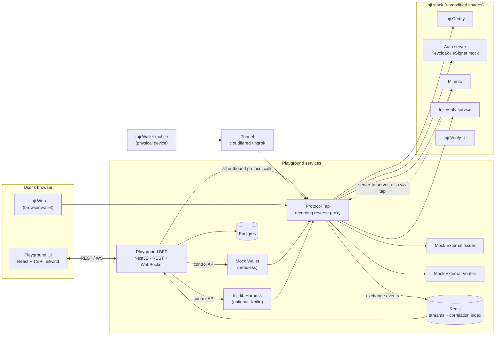
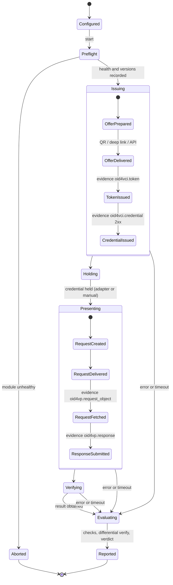
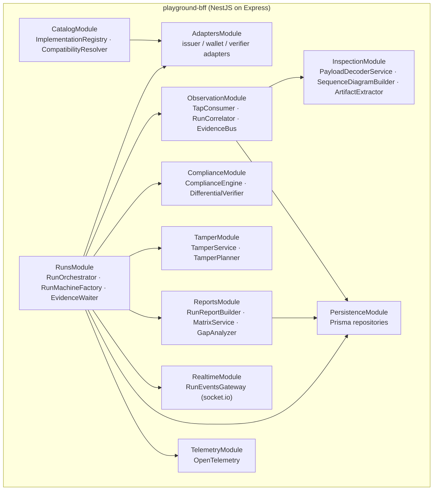
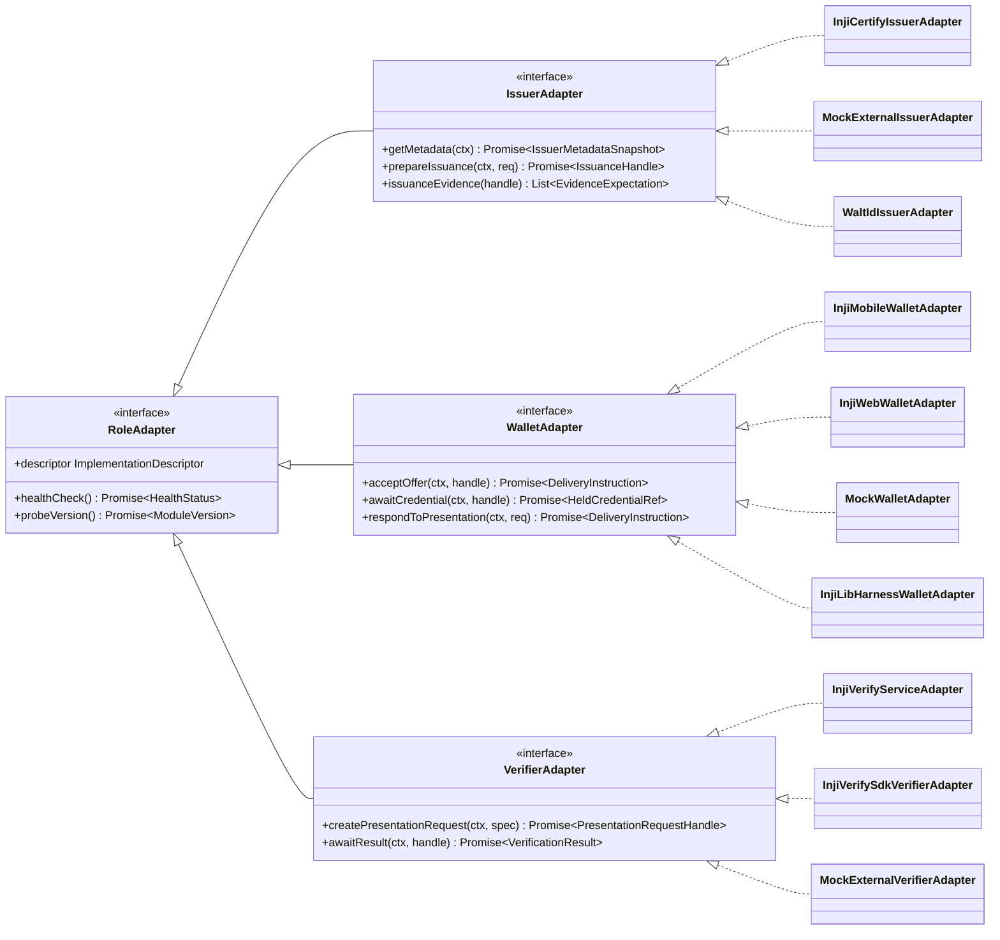
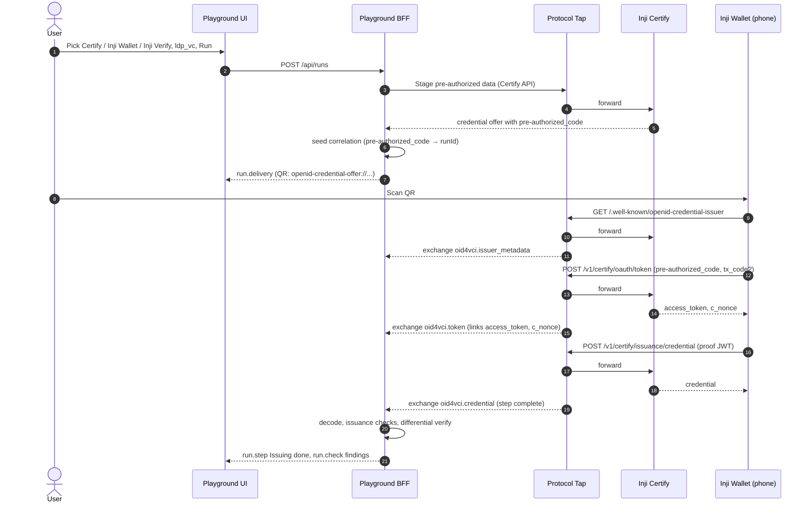
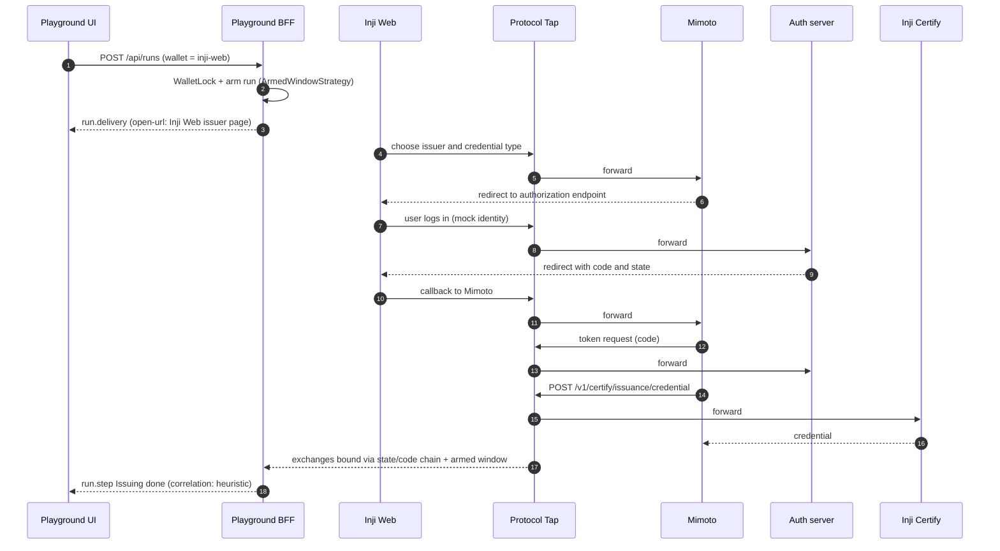
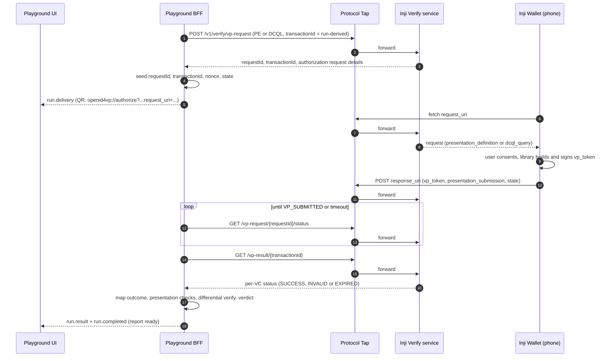
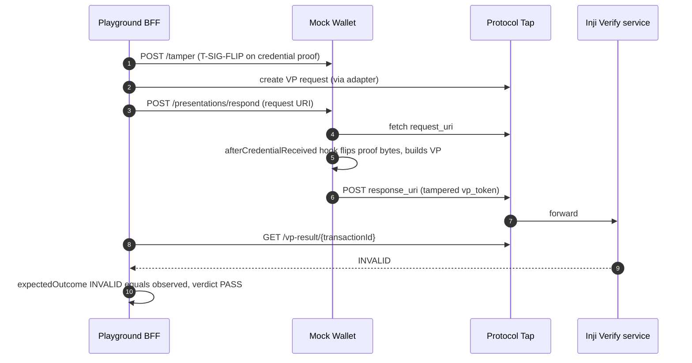

# Inji Interoperability Playground — Implementation Plan

*MOSIP Decode · Problem Statement 02 (Inji) · Design plan v1.0 · 30 Sep 2026*

> **How to read this.** Sections 1–4 explain *what* we build and *why it is shaped this way*. Sections 5–9 are the build spec (repo layout, domain model, every service and class). Sections 10–16 cover flows, data, checks, tampering, the test matrix, infrastructure, CI and telemetry. Sections 17–19 are the schedule, risks and deliverables.
>
> ⚠️ **Verify-before-coding markers.** The Inji modules move quickly: the repositories have moved from `github.com/mosip/*` to `github.com/inji/*`, and Inji Verify switched from Presentation Exchange to DCQL after 0.18.x. Anything marked ⚠️ is based on public docs at the time of writing and must be confirmed against the exact image tags you pin.

---

## Table of contents

1. [Summary and key design decisions](#1-summary-and-key-design-decisions)
2. [Problem-statement coverage map](#2-problem-statement-coverage-map)
3. [What the Inji stack speaks today](#3-what-the-inji-stack-speaks-today-ground-truth)
4. [Architecture](#4-architecture)
5. [Repository layout and tooling](#5-repository-layout-and-tooling)
6. [Domain model](#6-domain-model)
7. [Class catalogue — shared packages](#7-class-catalogue--shared-packages)
8. [Class catalogue — services](#8-class-catalogue--services)
9. [Playground UI](#9-playground-ui)
10. [End-to-end flows](#10-end-to-end-flows)
11. [Data model and APIs](#11-data-model-and-apis)
12. [Compliance checks catalogue](#12-compliance-checks-catalogue)
13. [Replay & tamper catalogue](#13-replay--tamper-catalogue)
14. [Interoperability test matrix](#14-interoperability-test-matrix)
15. [Infrastructure, networking and configuration](#15-infrastructure-networking-and-configuration)
16. [CI, telemetry and gap reporting](#16-ci-telemetry-and-gap-reporting)
17. [Delivery plan and team split](#17-delivery-plan-and-team-split)
18. [Risks and mitigations](#18-risks-and-mitigations)
19. [Deliverables checklist and demo script](#19-deliverables-checklist-and-demo-script)
20. [References](#20-references)

---

## 1. Summary and key design decisions

The playground is a web app backed by a handful of services. A user picks an **issuer**, a **wallet** and a **verifier**, picks a credential format, and runs a live **issue → hold → present → verify** cycle while watching every protocol message, every check result and every failure. Each run ends with a pass/fail interoperability report; runs accumulate into a compatibility matrix and a history that doubles as a regression tracker across Inji releases.

Six decisions shape everything else in this plan:

| # | Decision | Why |
|---|---|---|
| D1 | **Observe through a Protocol Tap instead of instrumenting the modules.** A recording reverse proxy becomes the *public face* of Inji Certify, the auth server, Mimoto, Inji Verify and the mocks. | Wallets talk to issuers and verifiers directly, so a BFF that only sees its own calls would miss most of the protocol. The tap captures every exchange of *unmodified* Inji images, which is what makes the interoperability claims credible. |
| D2 | **One adapter per implementation, behind three role interfaces** (`IssuerAdapter`, `WalletAdapter`, `VerifierAdapter`), each publishing a capability descriptor. | Adding walt.id or another verifier is one class plus one YAML entry. Capabilities let the UI predict incompatible combinations before a run starts. |
| D3 | **Runs are evidence-driven state machines.** A step completes when the orchestrator sees evidence: an adapter return value, a correlated tap exchange, or a manual confirmation. | This is what lets a human holding a phone (Inji Wallet) and a headless mock wallet be treated identically by the same orchestrator. |
| D4 | **A compliance-check engine runs over captured payloads**, and every report records *predicted vs observed* results plus *differential verification* (our independent verifier vs Inji Verify). | Pass/fail alone does not surface gaps. Spec-referenced checks and disagreements between verifiers do, which is Goal (b) of the problem statement. |
| D5 | **A headless Mock Wallet, plus an optional harness built on Inji's own wallet libraries.** | CI, tamper mode and repeatable demos all need a wallet that runs without a phone. |
| D6 | **One `docker compose` with profiles, and all config rendered from a single `.env`.** | It is a bonus task, and it removes the biggest hackathon time sink: hand-editing `mimoto-issuers-config.json`, properties files and URLs every time a hostname changes. |

### How this differs from existing community VC playgrounds

The problem statement asks us not to replicate the external playground. Our differences are structural rather than cosmetic:

- **Unmodified modules, observed from outside.** Real Inji images, a real phone and real Inji Web; the tap records traffic instead of the playground re-implementing the roles.
- **Predicted vs observed.** Capabilities predict whether a combination *should* work; the interesting output is where prediction and reality disagree.
- **Differential verification.** Every credential and presentation is verified twice (by the chosen verifier and by our independent verifier) and disagreements are flagged as findings.
- **Transit tampering.** Negative paths can be exercised with the real Inji Wallet by mutating messages inside the tap, not only with a mock wallet.
- **Version awareness.** Every run records module versions and protocol profile (OID4VCI draft 13 vs 1.0, Presentation Exchange vs DCQL).
- **Gap pipeline.** Failures cluster into "gap signatures" with auto-drafted GitHub issues containing full, redacted reproduction data.

---

## 2. Problem-statement coverage map

| PS item | Where it is implemented | Phase |
|---|---|---|
| **M1** Stand up Inji stack end-to-end | `infra/compose`, `scripts/render-config.ts`, `scripts/seed.ts` | P0 |
| **M2** 3-column Issuer → Wallet → Verifier selector | UI `RoleSelectorBoard`; BFF `ImplementationRegistry`, `CompatibilityResolver` | P1 |
| **M3** Live "Issue a Credential" flow | `InjiCertifyIssuerAdapter`, `InjiMobileWalletAdapter`, `InjiWebWalletAdapter`, Protocol Tap | P1–P2 |
| **M4** Live "Present & Verify" flow (Valid / Invalid / Valid-but-Expired) | `InjiVerifyServiceAdapter`, `InjiVerifySdkVerifierAdapter`, `VerificationResultCard` | P2 |
| **M5** Protocol inspector panel | Tap + `PayloadDecoderService` + UI `ProtocolInspector` | P2 |
| **M6** Two formats end-to-end, labelled per run | `LdpVcHandler`, `SdJwtVcHandler`, UI `FormatBadge` | P3 |
| **M7** Pass/fail report per run | `RunReportBuilder`, `VerdictCalculator`, Markdown/JSON/JUnit renderers | P3 |
| **G1** Non-Inji standards-compliant mock | `apps/mock-issuer`, `apps/mock-verifier` (optional walt.id adapters) | P4 |
| **G2** mDoc/mDL third format | `MsoMdocHandler`, Certify mock mDoc plugin configuration | P4 |
| **G3** Animated Mermaid sequence diagram | `SequenceDiagramBuilder` + UI `SequenceDiagramView` | P3 |
| **G4** Replay & tamper mode | `TamperService`, mock-wallet hooks, tap `TransitTamperRule` | P4 |
| **G5** Historical dashboard | `HistoryController`, UI `/history` | P4 |
| **G6** Same-device flow (deep link / DC API) | `PresentationFlow = same-device-deeplink / dc-api`, `DeliveryInstruction` | P4 |
| **B1** Nightly CI interop suite | `packages/interop-cli`, `.github/workflows/nightly-interop.yml` | P5 |
| **B2** File gaps as GitHub issues | `GapAnalyzer`, `GithubIssueDrafter` (human-reviewed filing) | P5 |
| **B3** Telemetry | OpenTelemetry + Grafana; optional `ObsrvEventExporter` | P5 |
| **B4** One-command Docker Compose | `make up` wrapping profiles and config rendering | P0 → P5 |

---

## 3. What the Inji stack speaks today (ground truth)

| Module | Protocols | Formats / crypto | Notes that matter for the playground |
|---|---|---|---|
| **Inji Certify** | OpenID4VCI **draft 13**. Credential offer with **pre-authorized code** ✅. Authorization via an external OAuth 2.0 server (eSignet or Keycloak). | JSON-LD (`ldp_vc`, W3C VCDM 1.1 and 2.0); SD-JWT with **`vc+sd-jwt` only**; mso_mdoc in **mock mode only**; **`jwt` proof type only**. | Canonical paths: `POST /v1/certify/oauth/token`, `POST /v1/certify/issuance/credential`. `mosip.certify.identifier` defaults to `mosip.certify.domain.url`, which must equal the tap's public hostname (see §4.3). Pre-auth details: `docs/technical_docs/Pre_Authorized_Code.md` in the repo. ⚠️ |
| **Inji Verify** | Up to 0.18.x: OpenID4VP with **Presentation Exchange** (`presentation_definition`). From 1.0.x: **DCQL**, OpenID4VP 1.0 Final. Cross-device QR and same-device (deep link, Digital Credentials API). | ldp_vc, SD-JWT (via `/vc-submission`), status-list revocation, SVG rendering. | Response mode `direct_post` (`direct_post.jwt` still in design). Endpoints used: `/vp-request` (a v2 variant takes DCQL), `/vp-request/{requestId}/status`, `/vp-result/{transactionId}`, `/vp-submission/direct-post`, `/vc-verification`. ⚠️ |
| **Inji Wallet (mobile)** | `inji-openid4vp` library documented against **draft 23** with `presentation_definition`; supports `direct_post.jwt`; sends wallet metadata on `request_uri` POST (since 0.17). | ldp_vc, SD-JWT, mso_mdoc. | `MIMOTO_HOST` is a **build-time** variable. Trusted verifiers come from Mimoto config. Needs HTTPS endpoints (use a tunnel). |
| **Inji Web + Mimoto** | OID4VCI through Mimoto; OID4VP through `/v1/mimoto/wallets/{walletId}/presentations/...` (DCQL handling visible in recent issues). | As above. | Mimoto needs Postgres and a Google OAuth client for logged-in wallets. |

**Implications built into this plan**

1. **Two verifier lanes.** Pin Inji Verify 0.18.x (the Presentation Exchange lane) *and* 1.0.x (the DCQL lane). Because Inji Wallet mobile's library is documented against draft 23 with `presentation_definition`, *Inji Wallet ↔ Inji Verify 1.0* is the first pairing to test and a likely first gap to report.
2. **Pre-authorized code first.** It lets the playground start issuance itself, gives exact correlation (§4.4), needs no login UI and no external auth server for the first milestone. The authorization-code flow (Inji Web through Mimoto) comes second.
3. **SD-JWT `typ`.** Certify issues `vc+sd-jwt` only, while IETF SD-JWT VC and OID4VCI 1.0 have moved to `dc+sd-jwt`. The mock issuer emits both so we can report who accepts what.
4. **Response modes.** The wallet supports `direct_post.jwt` and Inji Verify does not yet. The mock verifier supports both so the gap is measurable rather than anecdotal.
5. **Real bugs are being filed right now**, for example Mimoto returning HTTP 500 for DCQL queries with a `null` path segment (inji-web #727) and Inji Verify accepting malformed `redirect_uri:` client IDs (inji-verify #2241). The check engine (§12) is designed to catch exactly this class of issue.

---

## 4. Architecture

### 4.1 System context



Every protocol message between roles crosses the tap exactly once, including Mimoto's server-to-server calls to Certify and the auth server. The BFF never sits *between* a wallet and an issuer; it only starts flows, watches evidence and evaluates.

### 4.2 Logical layers

| Layer | Components | Responsibility |
|---|---|---|
| Presentation | Playground UI | Role selection, run canvas, inspector, reports, matrix, history |
| Orchestration | Playground BFF | Catalog, run state machines, correlation, checks, reports, persistence, WebSocket fan-out |
| Observation | Protocol Tap, Redis Streams | Capture, classify and correlate every HTTP exchange; optional transit tampering |
| Role implementations | Inji Certify, Mimoto, Inji Web, Inji Wallet, Inji Verify, mocks, harness | Actually issue, hold, present and verify |
| Infrastructure | Postgres, Redis, tunnel, OTel/Grafana | Storage, messaging, reachability, telemetry |

### 4.3 The Protocol Tap

**Host-based routing, not path-based.** Each upstream gets its own hostname (`certify.<domain>`, `auth.<domain>`, `mimoto.<domain>`, `verify.<domain>`, `injiweb.<domain>`, `mock-issuer.<domain>`, `mock-verifier.<domain>`). Path-prefix proxying breaks three things we depend on: `.well-known` locations, the rule that `credential_issuer` must equal the URL the metadata was fetched from, and `did:web` resolution (which always resolves at the host root).

**The "public face" rule.** Instead of rewriting responses, we configure each module's *own* public-URL properties to the tap hostname (for example `mosip.certify.domain.url=https://certify.<domain>`). Metadata, the proof JWT `aud`, `response_uri`, `request_uri` and DID documents then point through the tap naturally, and signatures stay valid because nothing in transit is modified.

**Routing table** (rendered from `.env` by `scripts/render-config.ts`):

```yaml
# infra/rendered/tap-routes.yaml
routes:
  - host: certify.${PUBLIC_DOMAIN}
    upstream: http://inji-certify:8090
    component: inji-certify
    role: issuer
  - host: auth.${PUBLIC_DOMAIN}
    upstream: http://keycloak:8080
    component: auth-server
    role: issuer-auth
  - host: mimoto.${PUBLIC_DOMAIN}
    upstream: http://mimoto:8099
    component: mimoto
    role: wallet-backend
  - host: verify.${PUBLIC_DOMAIN}
    upstream: http://inji-verify-service:8080
    component: inji-verify
    role: verifier
    cors:
      allowOrigins: ["https://playground.${PUBLIC_DOMAIN}"]   # SDK calls from the UI
  - host: mock-issuer.${PUBLIC_DOMAIN}
    upstream: http://mock-issuer:7001
    component: mock-issuer
    role: issuer
  - host: mock-verifier.${PUBLIC_DOMAIN}
    upstream: http://mock-verifier:7002
    component: mock-verifier
    role: verifier
limits:
  maxBodyBytes: 2097152
redaction:
  headers: [authorization, cookie, set-cookie, dpop]
  jsonFields: [access_token, refresh_token, pre-authorized_code, tx_code, code, client_secret]
  reveal: ${TAP_REVEAL_SECRETS:-false}
```

Upstream ports above are placeholders; take the real ones from the vendored upstream compose files. ⚠️

**Request pipeline:**

1. Receive the request and buffer its body (up to the cap).
2. If a `TransitTamperRule` is armed for the correlated run and step, mutate the request.
3. Forward to the upstream with `undici`, preserving method, headers and body.
4. Buffer the response (same cap); apply response-side tamper rules if armed.
5. Build an `Exchange` record → `ExchangeClassifier` assigns a `ProtocolStep` → `CorrelationKeyExtractor` pulls identifiers → `Redactor` masks secrets in the *stored* copy.
6. `XADD tap:exchanges` to Redis, then return the response to the caller unchanged (unless tampered).

The tap is a development tool. Redaction is on by default (first and last four characters kept), and the playground must only ever be pointed at mock issuers and mock identity data.

### 4.4 Correlation: attaching exchanges to runs

The tap sees raw HTTP; the BFF must work out which run each exchange belongs to.

- **Correlation keys**: `credential_offer` id, `pre-authorized_code`, `issuer_state`, `state`, authorization `code`, SHA-256 of `access_token`, `c_nonce`, VP `nonce`, Inji Verify `requestId` and `transactionId`, and the id segment of `request_uri` / `response_uri`.
- **Seeding**: when the BFF creates an offer or a presentation request, it registers the keys it knows (`pre-authorized_code → runId`, `requestId → runId`, and so on) in the `CorrelationIndex` (a Redis hash with TTL).
- **Transitive linking**: when one exchange contains a known key *and* introduces new ones, the new keys are linked to the same run. The token request carries the known pre-authorized code, so the `access_token` and `c_nonce` in its response become known; the credential request then correlates through the bearer token.
- **Passing our own IDs where the API allows it**: Inji Verify accepts an optional `transactionId` when creating a VP request, and the SDK components accept a `transactionId` prop, so the BFF passes a run-derived ID and gets exact correlation. ⚠️ confirm the prop on the SDK version you pin.
- **Fallback for user-initiated flows**: when the user starts issuance inside Inji Web, the BFF never sees the first request. The `ArmedWindowStrategy` binds the first uncorrelated OID4VCI flow from the expected component inside a time window to the armed run, and the report labels it `correlation: heuristic`. A `WalletLock` ensures only one armed run per wallet at a time, which keeps the heuristic safe in practice.

### 4.5 Evidence-driven run orchestration

Each run is an XState v5 actor. Steps wait for **evidence**, which comes from one of three sources: `adapter` (a return value, such as the mock wallet confirming it stored the credential), `tap` (a correlated exchange matching an `EvidenceExpectation`), or `manual` (the user clicking "credential visible in wallet"). An error response on an expected step fails that step immediately with the upstream error body attached; a timeout marks it `INCONCLUSIVE` for human-in-the-loop wallets and `FAIL` for headless ones.



Runs also support partial modes: `issue-only`, `present-only` (reuse a credential held from an earlier run) and `direct-verify` (paste or scan a VC, including a PixelPass QR, and send it to `/vc-verification`).

### 4.6 BFF module map



---

## 5. Repository layout and tooling

```
inji-interop-playground/
├── apps/
│   ├── playground-ui/          # Vite + React 18 + TypeScript + Tailwind
│   ├── playground-bff/         # NestJS (Express adapter) — orchestrator, REST, WebSocket
│   ├── protocol-tap/           # Fastify recording reverse proxy
│   ├── mock-issuer/            # OID4VCI issuer (draft 13 and 1.0 profiles, quirk switches)
│   ├── mock-verifier/          # OID4VP verifier (draft 21 / draft 23 / 1.0 profiles)
│   ├── mock-wallet/            # headless holder (OID4VCI + OID4VP) with tamper hooks
│   └── inji-lib-harness/       # optional Kotlin/Ktor wallet built on Inji libraries
├── packages/
│   ├── shared/                 # domain types, zod schemas, WebSocket event contracts
│   ├── protocol-core/          # OID4VCI/OID4VP builders & parsers, format handlers, crypto, QR
│   ├── compliance-checks/      # ComplianceCheck implementations (used by BFF and CLI)
│   └── interop-cli/            # CI runner and matrix publisher
├── catalog/                    # implementation descriptors (one YAML per implementation)
├── matrices/                   # run matrices: demo.yaml, nightly.yaml, tamper.yaml
├── infra/
│   ├── compose/                # docker-compose.yml + profile overrides
│   ├── config-templates/       # *.hbs → rendered into infra/rendered/
│   ├── vendor/                 # pinned copies of upstream compose/config (certify, mimoto, verify)
│   ├── contexts/               # cached JSON-LD contexts for offline verification
│   ├── keycloak/               # realm export for the auth-code flow
│   ├── postgres/init/          # creates certify, mimoto, inji_verify, playground databases
│   └── grafana/                # dashboards
├── scripts/                    # render-config.ts, seed.ts, tunnel-bootstrap.sh, make-truststore.sh, wait-for-health.ts
├── reports/                    # generated matrix + gap write-ups (committed by CI)
├── docs/                       # architecture.md, flows.md, adding-an-implementation.md, gaps/
├── .github/workflows/          # ci.yml, nightly-interop.yml
├── Makefile
└── README.md
```

**Tooling:** pnpm workspaces + Turborepo; TypeScript 5 in strict mode; zod for every schema that crosses a process boundary; Vitest for unit tests; Supertest for BFF API tests; Playwright for UI end-to-end tests; ESLint + Prettier; Husky pre-commit. License the repo MPL-2.0 to match the Inji projects.

**Key third-party libraries (all TypeScript):** `jose` (JWT/JWS/JWE), `@sd-jwt/core` + `@sd-jwt/sd-jwt-vc`, `jsonld` + `jsonld-signatures` + Digital Bazaar Ed25519/Data Integrity suites, `@sphereon/pex` (Presentation Exchange), a DCQL library such as the OpenWallet Foundation Labs `dcql` package, `@auth0/mdl` or `cbor-x` for mdoc, `did-resolver` + `key-did-resolver` + `web-did-resolver`, `@mosip/pixelpass`, `@mosip/react-inji-verify-sdk`, `xstate` v5, `socket.io`, `prisma`, `ioredis`, `undici`, `mermaid`, `qrcode`, `zustand`, `@tanstack/react-query`, `recharts`.

---

## 6. Domain model

All of these live in `packages/shared` and are shared by UI, BFF, mocks and CLI.

```ts
// ---------- roles & capabilities ----------
export type Role = 'issuer' | 'wallet' | 'verifier';
export type CredentialFormat = 'ldp_vc' | 'vc+sd-jwt' | 'dc+sd-jwt' | 'mso_mdoc' | 'jwt_vc_json';
export type ProofSuite =
  | 'Ed25519Signature2020' | 'Ed25519Signature2018' | 'RsaSignature2018'
  | 'EcdsaSecp256k1Signature2019' | 'DataIntegrityProof:eddsa-rdfc-2022'
  | 'ES256' | 'EdDSA' | 'RS256';
export type VciProfile = 'oid4vci-draft13' | 'oid4vci-1.0';
export type VpProfile = 'oid4vp-draft21' | 'oid4vp-draft23' | 'oid4vp-1.0';
export type QueryLanguage = 'presentation_exchange' | 'dcql';
export type ResponseMode = 'direct_post' | 'direct_post.jwt' | 'dc_api';
export type ClientIdScheme = 'redirect_uri' | 'pre-registered' | 'did' | 'x509_san_dns';
export type PresentationFlow = 'cross-device-qr' | 'same-device-deeplink' | 'dc-api';
export type DeliveryChannel = 'qr' | 'deeplink' | 'open-url' | 'api';
export type Automation = 'headless' | 'human-in-the-loop';

export interface Capabilities {
  formats: CredentialFormat[];
  proofSuites: ProofSuite[];
  grantTypes?: Array<'pre-authorized_code' | 'authorization_code'>;
  vciProfiles?: VciProfile[];
  vpProfiles?: VpProfile[];
  queryLanguages?: QueryLanguage[];
  responseModes?: ResponseMode[];
  clientIdSchemes?: ClientIdScheme[];
  didMethods?: string[];               // issuer DIDs it can resolve / holder DIDs it can use
  presentationFlows?: PresentationFlow[];
  deliveryChannels: DeliveryChannel[];
  automation: Automation;
  supportsTamper: boolean;
}

export interface ImplementationDescriptor {
  id: string;                          // 'inji-certify', 'mock-wallet', ...
  role: Role;
  displayName: string;
  vendor: 'inji' | 'mock' | 'external';
  adapter: string;                     // DI token resolved by ImplementationRegistry
  publicUrl: string;                   // tap hostname
  internalUrl?: string;
  versionProbe?: { kind: 'actuator' | 'static' | 'header'; value: string };
  capabilities: Capabilities;
  notes?: string;
}

// ---------- runs ----------
export type RunMode = 'full' | 'issue-only' | 'present-only' | 'direct-verify';
export type VerificationOutcome = 'VALID' | 'INVALID' | 'EXPIRED' | 'REVOKED' | 'REJECTED' | 'ERROR';
export type InteropVerdict = 'PASS' | 'PASS_WITH_WARNINGS' | 'FAIL' | 'INCONCLUSIVE' | 'NOT_APPLICABLE';

export interface RunConfig {
  mode: RunMode;
  issuerId: string;
  walletId: string;
  verifierId: string;
  format: CredentialFormat;
  credentialConfigurationId: string;
  proofSuite?: ProofSuite;
  grantType: 'pre-authorized_code' | 'authorization_code';
  issuerProfile?: string;              // mock-issuer quirk profile, e.g. 'sdjwt-dc-typ'
  vpProfile?: VpProfile;
  queryLanguage?: QueryLanguage;
  responseMode?: ResponseMode;
  presentationFlow: PresentationFlow;
  holderDidMethod?: 'did:jwk' | 'did:key';
  tamper?: TamperSpec;
  expectedOutcome: VerificationOutcome;  // VALID unless a tamper / expiry scenario
  labels?: Record<string, string>;
}

export interface PresentationSpec {       // one internal spec → PE or DCQL
  id: string;
  format: CredentialFormat;
  credentialTypes?: string[];           // ldp_vc
  vct?: string;                         // SD-JWT VC
  doctype?: string;                     // mso_mdoc
  requestedClaims?: string[][];         // claim paths, used for selective disclosure
  purpose?: string;
}

export interface TamperSpec {
  id: string;                           // 'T-SIG-FLIP' (see §13)
  mechanism?: 'wallet-hook' | 'direct-verify' | 'transit';   // chosen by TamperPlanner if omitted
  params?: Record<string, unknown>;
}

export interface VerificationResult {
  outcome: VerificationOutcome;
  perCredential: Array<{ index: number; outcome: VerificationOutcome; reason?: string }>;
  verifierRaw: unknown;                 // e.g. Inji Verify vp-result JSON, shown verbatim in the inspector
}

export type ArtifactKind =
  | 'offer' | 'credential' | 'auth_request' | 'presentation_definition' | 'dcql_query'
  | 'vp_token' | 'presentation_submission' | 'verification_result'
  | 'tampered_credential' | 'tampered_vp';

export enum ProtocolStep {
  VCI_ISSUER_METADATA = 'oid4vci.issuer_metadata',
  VCI_AS_METADATA = 'oid4vci.as_metadata',
  VCI_CREDENTIAL_OFFER = 'oid4vci.credential_offer',   // out-of-band QR/link, or offer_uri fetch
  VCI_AUTHORIZE = 'oid4vci.authorize',
  VCI_TOKEN = 'oid4vci.token',
  VCI_NONCE = 'oid4vci.nonce',                         // 1.0 nonce endpoint
  VCI_CREDENTIAL = 'oid4vci.credential',
  VP_AUTH_REQUEST = 'oid4vp.authorization_request',    // out-of-band QR/link
  VP_REQUEST_OBJECT = 'oid4vp.request_object',         // request_uri GET/POST
  VP_RESPONSE = 'oid4vp.response',                     // direct_post(.jwt)
  VERIFY_CREATE_REQUEST = 'verify.create_request',
  VERIFY_STATUS = 'verify.status_poll',
  VERIFY_RESULT = 'verify.result',
  VC_DIRECT_VERIFY = 'verify.vc_verification',
  DID_RESOLUTION = 'did.resolution',
  CONTEXT_FETCH = 'jsonld.context_fetch',
  STATUS_LIST_FETCH = 'status_list.fetch',
  WALLET_BACKEND = 'mimoto.api',
  UNKNOWN = 'unknown',
}

export interface Exchange {
  id: string;
  runId?: string;
  seq: number;
  ts: string;
  component: string;                    // from tap route
  from?: string;                        // inferred caller (wallet, mimoto, bff…)
  method: string;
  url: string;
  status?: number;
  latencyMs?: number;
  step: ProtocolStep;
  request: { headers: Record<string, string>; body?: string; contentType?: string };
  response?: { headers: Record<string, string>; body?: string; contentType?: string };
  correlationKeys: string[];
  outOfBand: boolean;                   // QR / deep-link payloads recorded by the BFF
  tampered?: { ruleId: string; diff: string };
}
```

**Verdict rule** (`VerdictCalculator`):

- `PASS` — observed outcome equals `expectedOutcome` and no check returned `FAIL`.
- `PASS_WITH_WARNINGS` — as above but at least one `WARN`.
- `NOT_APPLICABLE` — `CompatibilityResolver` predicted *unsupported* and the run failed at the predicted point (recorded as "known unsupported", not a gap).
- `INCONCLUSIVE` — a human-in-the-loop step timed out or a precondition (health, DNS, TLS) failed; this is an infrastructure problem, not an interop result.
- `FAIL` — everything else. A predicted-supported combination that fails, or a differential-verification disagreement, is always `FAIL` and feeds the gap pipeline.

Inji Verify's statuses map as `SUCCESS → VALID`, `INVALID → INVALID`, `EXPIRED → EXPIRED` (Valid-but-Expired in the UI).

---

## 7. Class catalogue — shared packages

### 7.1 `packages/protocol-core`

The protocol toolkit shared by the BFF, the mocks, the mock wallet and the CLI. Everything is pure and side-effect free except the HTTP clients, which accept an injected `fetch` so the tap and tests can wrap them.

**`oid4vci/`**

| Class | Responsibility | Key methods |
|---|---|---|
| `CredentialOfferBuilder` | Builds draft-13 / 1.0 credential offers and `openid-credential-offer://` URIs, by value or by `credential_offer_uri` | `build(opts)`, `toUri(offer, mode)` |
| `CredentialOfferParser` | Parses offer URIs/JSON and resolves `credential_offer_uri` | `parse(uri)`, `resolve(fetch)` |
| `IssuerMetadataClient` | Fetches issuer metadata and authorization-server metadata; validates against zod schemas per profile | `fetchIssuer(issuerUrl)`, `fetchAuthServer(asUrl)` |
| `TokenClient` | Token requests for pre-authorized code (+ `tx_code`) and authorization code + PKCE | `preAuthorized(code, txCode?)`, `authorizationCode(code, verifier, redirectUri)` |
| `PkceUtil` | Code verifier / S256 challenge | `create()` |
| `ProofJwtBuilder` | `openid4vci-proof+jwt` with `aud`, `iat`, `nonce`, and `kid` (did:jwk / did:key) or `jwk` | `build({ aud, nonce, key, alg, kidStyle })` |
| `CredentialRequestBuilder` | Per-format request bodies: `credential_definition` (ldp_vc), `vct` (SD-JWT), `doctype` (mdoc) for draft 13; `credential_configuration_id` + `proofs` for 1.0 | `forFormat(profile, format, config, proof)` |
| `CredentialClient` | Calls the credential endpoint; normalises draft-13 `credential` vs 1.0 `credentials[]` responses | `request(endpoint, token, body)` |

**`oid4vp/`**

| Class | Responsibility | Key methods |
|---|---|---|
| `AuthorizationRequestBuilder` | Builds requests for draft 21 / draft 23 / 1.0: `response_type=vp_token`, `response_mode`, `response_uri`, `nonce`, `state`, `client_id` (+ scheme), `presentation_definition` or `dcql_query`, `client_metadata` | `build(spec, profile, opts)`, `toUri(req, byReference)` |
| `RequestObjectSigner` | JAR signing (`oauth-authz-req+jwt`) | `sign(req, key)` |
| `AuthorizationRequestParser` | Parses `openid4vp://` and https deep links; fetches `request_uri` (GET, or POST with `wallet_metadata`); verifies JAR | `parse(uri)`, `resolve(opts)` |
| `ClientIdResolver` | Normalises the client-ID scheme whether it arrives as a separate `client_id_scheme` parameter (draft 21) or as a prefix on `client_id` (1.0) | `resolve(req) → { scheme, identifier }` |
| `PresentationSpecTranslator` | Converts one internal `PresentationSpec` into a Presentation Exchange definition or a DCQL query | `toPresentationDefinition(spec)`, `toDcql(spec)` |
| `PresentationDefinitionEvaluator` | Wraps `@sphereon/pex` for selection and `presentation_submission` | `select(pd, creds)`, `submission(selection)` |
| `DcqlEvaluator` | Wraps the DCQL library for matching and response shaping | `match(query, creds)` |
| `VpTokenBuilder` | Builds `ldp_vp` (Ed25519Signature2020 / Data Integrity / JsonWebSignature2020), SD-JWT + KB-JWT, and mdoc DeviceResponse (stretch) | `build(selection, holderKey, { nonce, aud })` |
| `VpTokenInspector` | Detects the shape of any `vp_token` (string, array, DCQL object keyed by query id) and decodes it | `inspect(vpToken, submission?)` |
| `ResponseSender` | Sends `direct_post` (form-encoded) or `direct_post.jwt` (JWE with the verifier's `client_metadata.jwks`) | `send(req, vpToken, submission?)` |

**`formats/`**

| Class | Responsibility | Key methods |
|---|---|---|
| `FormatHandler` *(interface)* | Common contract for every credential format | `detect(raw)`, `decode(raw)`, `verify(raw, ctx)`, `summarize(raw)` |
| `LdpVcHandler` | JSON-LD VCs: canonicalise, verify Ed25519Signature2020 and Data Integrity; RsaSignature2018 verification is best-effort and marked `delegated` if unsupported | as above |
| `SdJwtVcHandler` | Splits issuer JWT / disclosures / KB-JWT; recomputes digests; verifies issuer signature and key binding | `+ disclosures(raw)`, `+ verifyKeyBinding(raw, nonce, aud)` |
| `MsoMdocHandler` | Decodes IssuerSigned, MSO digests, validity info; verifies COSE_Sign1 with `x5chain` | `+ toDiagnostic(raw)` |
| `FormatDetector` | Sniffs format from raw bytes/strings | `detect(raw) → CredentialFormat` |
| `ContextDocumentLoader` | Offline-first JSON-LD loader backed by `infra/contexts`; records every context URL requested | `load(url)`, `requestedUrls()` |

**`crypto/`**

| Class | Responsibility | Key methods |
|---|---|---|
| `KeyManager` | Generates/imports Ed25519, P-256 and RSA keys; exports JWK; signs | `generate(alg)`, `toJwk()`, `sign(data)` |
| `DidResolver` | Resolves did:key, did:jwk and did:web; emits a `DID_RESOLUTION` event so resolution failures are visible | `resolve(did)` |
| `JwtCodec` | Decode without verifying (for the inspector) and verify with `jose` | `decode(jwt)`, `verify(jwt, keyLike)` |

**`qr/`**

| Class | Responsibility | Key methods |
|---|---|---|
| `PixelPassCodec` | Wraps `@mosip/pixelpass` encode/decode (check function names on the pinned version) | `encode(vc)`, `decode(qrData)` |
| `QrCapacityAnalyzer` | Computes payload bytes and the minimum QR version for each error-correction level; flags payloads beyond practical scanning limits — raw data for the "QR size limits" gap | `analyze(payload) → { bytes, minVersion, level, warning? }` |

### 7.2 `packages/compliance-checks`

```ts
export interface ComplianceCheck {
  id: string;                               // 'VCI-PROOF-001'
  title: string;
  stage: 'issuance' | 'presentation' | 'verification' | 'transport';
  severityOnFail: 'FAIL' | 'WARN';
  specRef: string;                          // human-readable, e.g. 'OID4VCI draft 13 — jwt proof type'
  appliesTo(evidence: RunEvidence): boolean;
  evaluate(evidence: RunEvidence): CheckFinding[];
}

export interface RunEvidence {
  config: RunConfig;
  exchanges: Exchange[];
  artifacts: Artifact[];                    // offer, credential, auth request, vp_token, result…
  descriptors: Record<Role, ImplementationDescriptor>;
  versions: ModuleVersion[];
}
```

Each check in §12 is one class (for example `ProofJwtTypCheck`, `CredentialIssuerOriginCheck`, `VpNonceBindingCheck`). `CheckRegistry` discovers them by decorator; the same package runs inside the BFF and inside the CLI.

### 7.3 `packages/shared`

Domain types (§6), zod schemas for every REST body and WebSocket event, the catalog YAML schema, and `RunEventMap` (the typed WebSocket contract used by both `RunEventsGateway` and the UI hook `useRunEvents`).

---

## 8. Class catalogue — services

### 8.1 `apps/protocol-tap` (Fastify, Node 20)

| Class | Responsibility | Key methods |
|---|---|---|
| `TapServer` | Boots HTTP/HTTPS listeners with SNI (wildcard cert in local mode), loads routes, wires hooks | `start()`, `stop()` |
| `RouteTable` | Host → upstream mapping from `tap-routes.yaml`; hot-reloads on change | `match(host) → Route` |
| `ProxyHandler` | Buffers bodies (with caps), forwards via `undici`, streams large responses without capture | `handle(req, reply)` |
| `CorsPolicy` | Adds CORS headers for configured origins (needed when the Verify SDK runs inside the playground UI) | `apply(route, req, reply)` |
| `ExchangeRecorder` | Builds the `Exchange` record, timings and sequence numbers | `record(req, res, timing)` |
| `ExchangeClassifier` | Ordered `ClassificationRule`s (component + method + path pattern + body shape) → `ProtocolStep` | `classify(exchange)` |
| `ClassificationRule` | One rule, e.g. `inji-certify POST /v1/certify/oauth/token → VCI_TOKEN` | `matches(ex)` |
| `CorrelationKeyExtractor` | Extracts keys from query strings, form bodies, JSON bodies, bearer tokens and responses | `extract(exchange) → string[]` |
| `Redactor` | Masks configured headers/fields in the stored copy | `redact(exchange)` |
| `ExchangePublisher` | Publishes to Redis Stream `tap:exchanges` | `publish(exchange)` |
| `TransitTamperRegistry` | Holds tamper rules armed by the BFF, keyed by run and step (control endpoint `POST /_tap/tamper-rules`) | `arm(rule)`, `find(ex)`, `disarm(runId)` |
| `TransitTamperRule` | Mutates a request or response in flight (e.g. flip one byte of the `vp_token` signature in a `direct_post`) | `applyRequest(ex)`, `applyResponse(ex)` |
| `TapHealthController` | `/_tap/health`, `/_tap/routes` | — |

### 8.2 `apps/playground-bff` (NestJS on Express)

#### Role adapter contracts

```ts
export interface RoleAdapter {
  readonly descriptor: ImplementationDescriptor;
  healthCheck(): Promise<HealthStatus>;
  probeVersion(): Promise<ModuleVersion>;
}

export interface IssuerAdapter extends RoleAdapter {
  getMetadata(ctx: RunContext): Promise<IssuerMetadataSnapshot>;
  listCredentialConfigurations(): Promise<CredentialConfigurationSummary[]>;
  /** Stage claims and create a pre-auth credential offer, or return an auth-code entry point. */
  prepareIssuance(ctx: RunContext, req: IssuanceRequest): Promise<IssuanceHandle>;
  /** Tap evidence that proves issuance completed for this handle. */
  issuanceEvidence(handle: IssuanceHandle): EvidenceExpectation[];
}

export interface WalletAdapter extends RoleAdapter {
  acceptOffer(ctx: RunContext, handle: IssuanceHandle): Promise<DeliveryInstruction>;
  awaitCredential(ctx: RunContext, handle: IssuanceHandle): Promise<HeldCredentialRef>;
  respondToPresentation(ctx: RunContext, req: PresentationRequestHandle): Promise<DeliveryInstruction>;
  applyTamper?(ctx: RunContext, spec: TamperSpec): Promise<void>;
}

export interface VerifierAdapter extends RoleAdapter {
  createPresentationRequest(ctx: RunContext, spec: PresentationSpec): Promise<PresentationRequestHandle>;
  awaitResult(ctx: RunContext, handle: PresentationRequestHandle): Promise<VerificationResult>;
  verifyCredentialDirect?(ctx: RunContext, credential: RawCredential): Promise<VerificationResult>;
}

export type DeliveryInstruction =
  | { kind: 'qr'; payload: string; bytes: number; qrVersion: number; hint: string; expiresAt?: string }
  | { kind: 'deeplink'; url: string; hint: string }
  | { kind: 'open-url'; url: string; hint: string }
  | { kind: 'automated' };

export interface EvidenceExpectation {
  step: ProtocolStep;
  component?: string;                       // upstream that must see it
  predicate?: (ex: Exchange) => boolean;    // e.g. status 2xx and body has 'credential'
  timeoutMs: number;
  optional?: boolean;
}
```



#### Adapter implementations

| Class | Role | Automation | How it works |
|---|---|---|---|
| `InjiCertifyIssuerAdapter` | issuer | — | **Pre-auth:** calls Certify's pre-authorized data / credential-offer API (canonical paths in `docs/technical_docs/Pre_Authorized_Code.md` ⚠️) with mock subject claims → offer URI. **Auth-code:** returns the issuer entry point for wallet-initiated flows. Metadata via the tap. Evidence: `POST /v1/certify/oauth/token` and `POST /v1/certify/issuance/credential` with 2xx. |
| `MockExternalIssuerAdapter` | issuer | — | `POST /admin/offers` on the mock issuer with the selected quirk profile. |
| `WaltIdIssuerAdapter` *(optional)* | issuer | — | Uses the walt.id community-stack issuer API to create offers — a genuinely third-party issuer. |
| `InjiMobileWalletAdapter` | wallet | human-in-the-loop | Returns `qr` instructions (credential offer, VP request); completion is tap evidence. `supportsTamper=false` (transit tampering still works). |
| `InjiWebWalletAdapter` | wallet | human-in-the-loop | Issuance: arms the run and returns `open-url` to Inji Web's issuer page; evidence is Mimoto ↔ Certify/auth-server traffic. Presentation: returns the Inji Web URL that receives the OpenID4VP request (web online sharing) ⚠️ confirm URL shape. |
| `MockWalletAdapter` | wallet | headless | Calls the mock wallet REST API; full tamper support. |
| `InjiLibHarnessWalletAdapter` *(optional)* | wallet | headless | Same contract as the mock wallet, but the harness runs Inji's own `inji-vci-client` / `inji-openid4vp` logic. |
| `InjiVerifyServiceAdapter` | verifier | — | Creates the VP request (Presentation Exchange body for ≤ 0.18.x, DCQL body for 1.0.x, chosen by `InjiVerifyVersionNegotiator`), passes a run-derived `transactionId`, builds the `openid4vp://` QR, polls `/vp-request/{requestId}/status` until `VP_SUBMITTED`, then fetches `/vp-result/{transactionId}`. Direct mode: `/vc-verification`. |
| `InjiVerifySdkVerifierAdapter` | verifier | — | The verifier runs inside the UI as `<OpenID4VPVerification>` with `verifyServiceUrl` set to the tap host. The UI forwards `onVpReceived(txnId)` to the BFF, which fetches the result server-side (the SDK docs recommend backend retrieval over trusting client-side results). |
| `MockExternalVerifierAdapter` | verifier | — | Creates a request on the mock verifier with the selected profile (draft 21 / 23 / 1.0, PE or DCQL, `direct_post` or `direct_post.jwt`). |

Supporting classes: `InjiVerifyVersionNegotiator` (reads the version probe and picks the request dialect), `AuthorizationRequestUriFactory` (QR vs deep-link encoding, `request_uri` vs by-value), `IssuanceRequestFactory` (mock subject data per credential configuration).

#### Orchestration and observation

| Class | Responsibility | Key methods |
|---|---|---|
| `RunOrchestrator` | Creates, starts, cancels and replays runs; owns one XState actor per run | `create(config)`, `start(runId)`, `cancel(runId)`, `replay(runId, overrides)` |
| `RunMachineFactory` | Builds the machine for a `RunMode`, wiring adapter calls and evidence waits per state | `build(ctx)` |
| `RunContext` | Per-run bag: config, resolved adapters, keys, artifacts, logger, abort signal | — |
| `EvidenceBus` | RxJS subject fed by `TapConsumer`, adapters and `ManualEvidenceService` | `emit(evidence)`, `stream(runId)` |
| `EvidenceWaiter` | Resolves when expectations match; rejects immediately on an error exchange for the expected step, or on timeout | `waitFor(runId, expectations, signal)` |
| `TapConsumer` | Redis Streams consumer group `bff` on `tap:exchanges`; persists and forwards exchanges | `onModuleInit()`, `handle(entry)` |
| `RunCorrelator` | Seeds, extends and queries correlation keys; applies `ArmedWindowStrategy` when nothing matches | `seed(runId, keys)`, `correlate(ex) → runId?` |
| `CorrelationIndex` | Redis hash `corr:<key> → runId` with TTL | `get`, `link`, `linkAll` |
| `ArmedWindowStrategy` | Heuristic binding for user-initiated flows; marks the run `correlation: heuristic` | `arm(runId, walletId, windowMs)`, `tryBind(ex)` |
| `WalletLock` | Guarantees one armed run per human-in-the-loop wallet | `acquire(walletId, runId)`, `release()` |
| `ManualEvidenceService` | Records user confirmations such as "credential visible in wallet" | `confirm(runId, step, note)` |
| `RunEventsGateway` | socket.io gateway, one room per run; emits typed `RunEventMap` events | `emit(runId, event)` |

#### Inspection, compliance and tampering

| Class | Responsibility | Key methods |
|---|---|---|
| `PayloadDecoderService` | Raw → decoded tree: JWT header/payload/signature status, SD-JWT disclosures, JSON-LD proof, CBOR diagnostic, form bodies, PixelPass | `decode(exchange)`, `decodeArtifact(artifact)` |
| `ArtifactExtractor` | Pulls offer, credential, authorization request, `presentation_definition` / `dcql_query`, `vp_token`, `presentation_submission` and verification result into typed artifacts | `extract(exchange) → Artifact[]` |
| `SequenceDiagramBuilder` | Turns ordered exchanges into Mermaid `sequenceDiagram` source; participants from descriptors; every arrow carries an `exchangeId` for click-through | `build(runId)`, `append(exchange)` |
| `ComplianceEngine` | Runs applicable checks after each phase and at the end; persists findings; emits `run.check` | `evaluate(runId, phase)` |
| `DifferentialVerifier` | Independently verifies the issued credential and the VP with `protocol-core`; compares to the verifier's verdict (check `VER-002`) | `verify(evidence) → DifferentialResult` |
| `CompatibilityResolver` | Intersects capability descriptors to predict support, with reasons (e.g. "wallet: PE only; verifier: DCQL only") | `predict(config) → Prediction` |
| `TamperService` | Applies a `TamperSpec` through the right mechanism | `prepare(ctx)` |
| `TamperPlanner` | Chooses the mechanism: mock-wallet hook, direct-verify, or tap transit rule | `plan(spec, wallet, verifier)` |
| `TamperStrategy` *(interface)* + strategies | One class per tamper in §13 | `applyToCredential`, `applyToVpToken`, `applyToExchange` |

#### Reporting, history and platform

| Class | Responsibility | Key methods |
|---|---|---|
| `RunReportBuilder` | Assembles config, versions, timeline, artifacts, findings, differential result and verdict | `build(runId) → RunReport` |
| `VerdictCalculator` | Implements the verdict rule in §6 | `calculate(evidence, findings, prediction)` |
| `MarkdownReportRenderer` / `JsonReportRenderer` / `JUnitReportRenderer` | Report outputs (JUnit for CI) | `render(report)` |
| `MatrixService` | Latest verdict per (issuer, wallet, verifier, format, profile) with predicted vs observed | `matrix(filters)` |
| `MatrixMarkdownRenderer` | `reports/interop-matrix.md` | `render(matrix)` |
| `HistoryService` | Filterable run history (module version, format, outcome, date range) and trend series | `query(filters)`, `trend(metric)` |
| `GapAnalyzer` | Clusters failures into gap signatures (check id + error code + component + versions) | `analyze(since) → Gap[]` |
| `GithubIssueDrafter` | Renders issue drafts with redacted reproduction data; filing stays a human action | `draft(gap)` |
| `ImplementationRegistry` | Loads `catalog/*.yaml`, validates with zod, instantiates adapters by DI token | `list()`, `get(id)`, `adapterFor(id)` |
| `ModuleVersionProbe` | Reads `/actuator/info` or configured version sources; falls back to image tags from `.env` | `probe(descriptor)` |
| `HealthService` | Periodic health checks → `catalog.health` events | `check(id)` |
| `ArtifactStore`, `RunRepository`, `ExchangeRepository`, `GapRepository` | Prisma-backed persistence | CRUD |
| `TelemetryService` | OpenTelemetry spans and metrics (§16.3) | `startRunSpan()`, `recordStep()` |

### 8.3 `apps/mock-issuer` (Fastify, TypeScript)

A deliberately configurable OID4VCI issuer: standards-compliant by default, with switchable deviations ("quirk profiles") so we can see exactly how Inji Wallet, Inji Web and Inji Verify react to issuers from other ecosystems.

| Class | Responsibility |
|---|---|
| `MockIssuerServer` | Bootstraps routes, keys and profile selection |
| `IssuerMetadataController` | `/.well-known/openid-credential-issuer` (draft 13 or 1.0 shape) |
| `AuthServerController` | `/.well-known/oauth-authorization-server`, `/authorize` (mock login page), `/token` |
| `OfferController` | `POST /admin/offers` → pre-auth offer (optional `tx_code`) |
| `NonceController` | `/nonce` (1.0 profile only) |
| `CredentialController` | `/credential`; validates proof JWT (`typ`, `aud`, `nonce`, `alg`) |
| `PreAuthCodeStore`, `NonceService`, `AccessTokenService` | Short-lived state |
| `CredentialFactory` | Delegates to format signers |
| `LdpVcSigner` | W3C VCDM 1.1 / 2.0 with Ed25519Signature2020 or Data Integrity `eddsa-rdfc-2022` |
| `SdJwtVcIssuer` | SD-JWT VC with `typ` `vc+sd-jwt` or `dc+sd-jwt`, configurable disclosure frame |
| `MdocIssuer` | mso_mdoc (stretch; `@auth0/mdl`) |
| `IssuerKeyRing` | Issuer keys; did:web / did:key identifiers |
| `DidWebDocumentController` | `/.well-known/did.json` |
| `StatusListController` | Bitstring status list for revocation scenarios |
| `QuirkProfile` | Switch set applied across controllers |

**Quirk profiles**

| Profile | Deviation | What it tells us |
|---|---|---|
| `strict-draft13` | None | Baseline: the mock matches what Inji expects |
| `oid4vci-1.0` | `credential_configuration_id` requests, `proofs` object, nonce endpoint, `credentials[]` response | Can Inji Wallet talk to 1.0 issuers (e.g. EUDI-style)? |
| `sdjwt-dc-typ` | SD-JWT with `typ: dc+sd-jwt` and format `dc+sd-jwt` | Do Inji Wallet / Inji Verify accept the newer SD-JWT VC identifier? |
| `expired-credential` | Correctly signed credential with `validUntil` / `expirationDate` in the past | Produces a genuine **Valid-but-Expired** case |
| `revoked-credential` | Status list entry set | Revocation handling |
| `unresolvable-context` | Custom JSON-LD context URL that does not resolve | Context-loading behaviour of wallets and verifiers |
| `did-key-issuer` | Issuer DID is did:key instead of did:web | DID method gaps |
| `large-credential` | Adds a large embedded image claim | QR size limits for offline sharing |

### 8.4 `apps/mock-verifier` (Fastify, TypeScript)

| Class | Responsibility |
|---|---|
| `MockVerifierServer` | Bootstraps routes, keys and profile selection |
| `VerifierProfile` | `oid4vp-draft21` (separate `client_id_scheme`, PE), `oid4vp-draft23` (the dialect `inji-openid4vp` documents), `oid4vp-1.0` (DCQL, client-ID prefixes) |
| `AuthorizationRequestService` | Creates transactions; `POST /admin/requests` returns the QR/deep-link URI |
| `RequestObjectController` | `GET`/`POST /request/:id` → JSON or signed JAR; records `wallet_metadata` when POSTed |
| `ResponseController` | `POST /response/:id` for `direct_post`; decrypts `direct_post.jwt` |
| `VpValidationPipeline` | Ordered stages, each producing findings: `ResponseShapeStage` → `StateStage` → `NonceAudienceStage` → `SubmissionMappingStage` (PE) or `DcqlMatchStage` → `HolderBindingStage` → `CredentialSignatureStage` → `StatusStage` → `ExpiryStage` |
| `VerifierKeyRing` | JAR signing keys and JWE decryption keys (published in `client_metadata.jwks`) |
| `TransactionStore` | Request/response state with TTL |
| `ResultController` | `GET /result/:txn` → outcome + per-stage findings |

For Inji Wallet, a `redirect_uri`-scheme client needs no registration; a `pre-registered` client must be added to Mimoto's trusted-verifiers config, which `render-config.ts` does automatically.

### 8.5 `apps/mock-wallet` (Fastify, TypeScript, headless)

| Class | Responsibility |
|---|---|
| `MockWalletServer` | REST API used by `MockWalletAdapter` and the CLI |
| `WalletKeyStore` | Holder keys; did:jwk and did:key identifiers |
| `CredentialStore` | Held credentials (Postgres schema `mock_wallet`) |
| `Oid4vciHolderService` | Offer → issuer metadata → token (pre-auth + `tx_code`, or auth-code + PKCE with scripted login) → proof → credential |
| `Oid4vpHolderService` | Parse request → resolve `request_uri` (sending wallet metadata) → match (PE or DCQL) → build VP → send |
| `ConsentPolicy` | Auto-approve; chooses claims to disclose for SD-JWT |
| `WalletMetadataProvider` | Advertised formats, algorithms and response modes |
| `TamperHooks` | `beforeProofSign`, `afterCredentialReceived`, `beforeVpSign`, `afterVpSign`, `beforeSend` — where tamper strategies plug in |
| `ReplayCache` | Keeps previously sent `vp_token`s for replay tests |

API: `POST /offers/accept`, `GET /credentials`, `DELETE /credentials/:id`, `POST /presentations/respond`, `POST /credentials/:id/qr` (PixelPass QR for offline scan tests), `POST /tamper` (arm hooks for the next action).

### 8.6 `apps/inji-lib-harness` (optional, Kotlin + Ktor)

A headless wallet that exercises **Inji's own wallet-side libraries** (`inji-vci-client`, `inji-openid4vp`, `vcverifier`) instead of our TypeScript re-implementation. When the mock wallet passes but the harness fails (or vice versa), the difference is a strong, library-specific gap signal. Both libraries are Kotlin Multiplatform; published artifacts are primarily Android `aar`s, so use a JVM artifact if one exists for your version, or build the JVM target from source. ⚠️ If neither works in time, drop this component — nothing else depends on it.

| Class | Responsibility |
|---|---|
| `HarnessApplication` | Ktor bootstrap; exposes the same REST contract as the mock wallet |
| `VciClientService` | Drives `inji-vci-client` for offer / token / credential |
| `OpenId4VpService` | Drives `inji-openid4vp`: authenticate the verifier's request, construct the unsigned VP token, sign it, share it (use the method names from the library README of the pinned version) |
| `HolderKeyProvider` | Software keys standing in for the Android Keystore |
| `HarnessController` | REST endpoints |

### 8.7 `packages/interop-cli` (Node, commander)

| Class | Responsibility |
|---|---|
| `InteropCli` | Commands: `run`, `matrix`, `report`, `gaps`, `health` |
| `MatrixLoader` | Expands `matrices/*.yaml` (axes, include, exclude) into `RunConfig`s; drops predicted-unsupported combinations unless `--include-unsupported` |
| `MatrixRunner` | Drives runs through the BFF API with bounded concurrency (one run per stateful wallet at a time); `--headless-only` filter |
| `ResultPublisher` | Writes JUnit XML, `interop-matrix.md`, `results.json`; optional commit to `reports/` |
| `BadgeGenerator` | Shields-style JSON badge for the README |

---

## 9. Playground UI

### 9.1 Pages

| Route | Purpose |
|---|---|
| `/` Playground | Three-column role selector, run configuration, live run canvas |
| `/runs/:id` | Run detail: timeline, sequence diagram, inspector, checks, report downloads, replay/tamper buttons |
| `/matrix` | Compatibility matrix (predicted vs observed), filterable by format and profile |
| `/history` | Run history and trends, filters by module version, format, outcome and date |
| `/verify` | Direct verification: paste JSON, upload a file, or scan a PixelPass QR with the SDK's `QRCodeVerification` |
| `/gaps` | Clustered failures with drafted GitHub issues |
| `/settings` | Endpoint health, tunnel status, pinned module versions, reveal-secrets toggle (local only) |

### 9.2 Layout sketch

```
┌──────────────────────────────────────────────────────────────────────────────┐
│ Inji Interop Playground        Playground · Matrix · History · Verify · Gaps │
├────────────────┬────────────────┬────────────────┬───────────────────────────┤
│ ISSUER         │ WALLET         │ VERIFIER       │ RUN CONFIG                │
│ ● Inji Certify │ ● Inji Mobile  │ ● Inji Verify  │ Format   [ldp_vc      ▾]  │
│ ○ Mock issuer  │ ○ Inji Web     │ ○ Verify SDK   │ Proof    [Ed25519-2020 ▾] │
│ ○ walt.id      │ ○ Mock wallet  │ ○ Mock RP      │ Flow     [cross-device ▾] │
│ v0.12.x  ✓     │ human-in-loop  │ v1.0.x ✓ DCQL  │ Tamper   [none        ▾]  │
├────────────────┴────────────────┴────────────────┤ ⚠ Predicted: wallet sends │
│ ▶ Run    Issue ──●── Hold ──○── Present ── Verify│   PE, verifier wants DCQL │
├──────────────────────────────────┬───────────────┴───────────────────────────┤
│ Sequence diagram (live)          │ Protocol inspector                        │
│ Wallet → Certify: POST /token    │ [Raw] [Decoded] [Headers] [Checks]        │
│ Certify → Wallet: 200 c_nonce    │ { "access_token": "eyJh…Q", "c_nonce": … }│
│ Wallet → Certify: POST /credential                                           │
├──────────────────────────────────┴───────────────────────────────────────────┤
│ Result: ✅ VALID    Verdict: PASS (2 warnings)    [Report .md] [.json] [Replay]│
└──────────────────────────────────────────────────────────────────────────────┘
```

### 9.3 Component catalogue

| Component | Responsibility |
|---|---|
| `AppShell`, `NavBar` | Layout, navigation, theme |
| `RoleSelectorBoard` | Three `RoleColumn`s; disables cards the resolver marks incompatible (with tooltip reasons) |
| `RoleColumn` → `ImplementationCard` | Name, vendor badge, version, health dot, capability chips, automation badge |
| `RunConfigPanel` | `FormatPicker`, `CredentialConfigPicker` (from issuer metadata), `ProofSuitePicker`, `FlowPicker`, `ProfilePicker` (PE / DCQL, draft), `HolderDidPicker`, `TamperPicker`, `ExpectationBadge` |
| `CompatibilityHint` | Shows the prediction and its reasons before the run starts |
| `RunCanvas` | Hosts the stepper, delivery panel and live panels for the active run |
| `PhaseStepper` | Issue → Hold → Present → Verify with per-step status, durations and evidence type icons |
| `DeliveryPanel` | `QrDisplay` (with byte size and QR version), `DeepLinkButton`, `OpenUrlButton`, `CountdownTimer`, instructions for human-in-the-loop wallets, "I can see the credential" confirmation |
| `CredentialCard` | Renders the held credential from claims plus issuer `display` metadata |
| `SequenceDiagramView` | Renders Mermaid incrementally, animates the newest arrow, highlights failures in red; click an arrow → inspector jumps to that exchange |
| `ProtocolInspector` | `ExchangeList` + `ExchangeDetail` tabs: Raw, Decoded, Headers, Checks |
| `JwtView`, `SdJwtView`, `JsonLdView`, `CborView` | Format-specific decoded views (SD-JWT shows a disclosures table with digest match status) |
| `DiffView` | Original vs tampered payload |
| `VerificationResultCard` | Large VALID / INVALID / VALID-BUT-EXPIRED / REJECTED banner with the verifier's raw result |
| `ComplianceChecksPanel` | Findings grouped by stage, with spec references and links to exchanges |
| `RunReportView` | Report preview and downloads (Markdown, JSON) |
| `SdkVerifierEmbed` | Wraps `<OpenID4VPVerification>` for the "Inji Verify SDK" verifier option |
| `SdkQrScanVerify` | Wraps `<QRCodeVerification>` for `/verify` |
| `CompatibilityMatrixGrid` | Rows = issuer × wallet, columns = verifier × format; cells show observed verdict with a predicted-status corner marker |
| `RunsTable`, `HistoryFilters`, `TrendChart` | History dashboard (recharts) |
| `GapList`, `IssueDraftView` | Gap clusters and copyable GitHub issue drafts |

**State and data:** `zustand` store for the current selection and run config; TanStack Query for REST resources; `useRunEvents(runId)` subscribes to the socket.io room and folds events into the run view model; `useCatalog()`, `useRun()`, `useMatrix()`, `useHistory()`.

---

## 10. End-to-end flows

### 10.1 Issue: Inji Certify → Inji Wallet mobile (pre-authorized code)



### 10.2 Issue: Inji Certify → Inji Web (authorization code through Mimoto)



### 10.3 Present & verify: Inji Wallet → Inji Verify (cross-device)



### 10.4 Same-device and Digital Credentials API

- **Same-device deep link:** `DeliveryInstruction.kind = 'deeplink'`. The UI shows a button that opens `openid4vp://…` on the phone's own browser; the wallet completes the flow and redirects back. Correlation is identical to 10.3.
- **Digital Credentials API:** when the verifier supports the DC API response mode and the browser exposes `navigator.credentials.get` with digital credentials, `SdkVerifierEmbed` uses the SDK's same-device path. Record the browser and OS in the run labels, because DC API support differs across platforms.

### 10.5 Tamper run: Mock Wallet → Inji Verify (bad signature)



With the real Inji Wallet, the same scenario uses a `TransitTamperRule` in the tap instead of a wallet hook: the wallet sends a valid VP, and the tap mutates it on the way to Inji Verify.

---

## 11. Data model and APIs

### 11.1 Postgres schema (Prisma)

```prisma
model Run {
  id               String          @id @default(uuid())
  createdAt        DateTime        @default(now())
  finishedAt       DateTime?
  trigger          String          // ui | cli | nightly
  mode             String          // full | issue-only | present-only | direct-verify
  issuerId         String
  walletId         String
  verifierId       String
  format           String
  proofSuite       String?
  grantType        String?
  issuerProfile    String?
  vpProfile        String?
  queryLanguage    String?
  responseMode     String?
  presentationFlow String?
  holderDidMethod  String?
  tamperId         String?
  expectedOutcome  String
  observedOutcome  String?
  predicted        String?         // supported | unsupported | unknown
  verdict          String?
  correlation      String          @default("exact")  // exact | heuristic
  errorSummary     String?
  labels           Json?
  steps            RunStep[]
  exchanges        Exchange[]
  findings         CheckFinding[]
  artifacts        Artifact[]
  versions         ModuleVersion[]
  @@index([issuerId, walletId, verifierId, format])
  @@index([createdAt])
  @@index([verdict])
}

model RunStep {
  id           String    @id @default(uuid())
  runId        String
  run          Run       @relation(fields: [runId], references: [id], onDelete: Cascade)
  phase        String    // issuing | holding | presenting | verifying
  step         String    // ProtocolStep or machine state
  status       String    // pending | active | done | failed | skipped | inconclusive
  evidenceKind String?   // adapter | tap | manual
  startedAt    DateTime?
  endedAt      DateTime?
  detail       Json?
}

model Exchange {
  id              String   @id @default(uuid())
  runId           String?
  run             Run?     @relation(fields: [runId], references: [id], onDelete: Cascade)
  seq             Int
  ts              DateTime
  component       String
  caller          String?
  method          String
  url             String
  status          Int?
  latencyMs       Int?
  step            String
  reqHeaders      Json
  reqBody         String?
  resHeaders      Json?
  resBody         String?
  correlationKeys String[]
  outOfBand       Boolean  @default(false)
  tamperRuleId    String?
  @@index([runId, seq])
}

model CheckFinding {
  id         String  @id @default(uuid())
  runId      String
  run        Run     @relation(fields: [runId], references: [id], onDelete: Cascade)
  checkId    String
  stage      String
  severity   String  // PASS | INFO | WARN | FAIL
  message    String
  specRef    String
  exchangeId String?
}

model Artifact {
  id               String  @id @default(uuid())
  runId            String
  run              Run     @relation(fields: [runId], references: [id], onDelete: Cascade)
  kind             String  // offer | credential | auth_request | presentation_definition | dcql_query | vp_token | presentation_submission | verification_result | tampered_credential | tampered_vp
  format           String?
  raw              String
  decoded          Json?
  sourceExchangeId String?
}

model ModuleVersion {
  id               String  @id @default(uuid())
  runId            String
  run              Run     @relation(fields: [runId], references: [id], onDelete: Cascade)
  implementationId String
  version          String
  imageRef         String?
  gitSha           String?
}

model Gap {
  id            String   @id @default(uuid())
  signature     String   @unique
  title         String
  components    String[]
  firstSeenRun  String
  lastSeenRun   String
  occurrences   Int      @default(1)
  status        String   // open | drafted | filed | wont-fix | fixed
  githubUrl     String?
  draftMarkdown String
}
```

Raw exchanges can get large; a retention job keeps full bodies for 30 days and truncates older ones to decoded summaries, while `Run`, `CheckFinding` and `ModuleVersion` stay forever for the history dashboard.

### 11.2 BFF REST API

| Method | Path | Purpose |
|---|---|---|
| GET | `/api/catalog` | Implementations with capabilities, health and version |
| GET | `/api/catalog/:id/credential-configurations` | Credential configurations from issuer metadata |
| POST | `/api/compatibility/predict` | `RunConfig` → prediction with reasons |
| POST | `/api/runs` | Create and start a run |
| GET | `/api/runs` | History with filters: issuer, wallet, verifier, format, verdict, moduleVersion, from, to |
| GET | `/api/runs/:id` | Run with steps, verdict and prediction |
| GET | `/api/runs/:id/exchanges?decode=true` | Captured exchanges, optionally decoded |
| GET | `/api/runs/:id/sequence` | Mermaid source for the sequence diagram |
| POST | `/api/runs/:id/manual-evidence` | User confirmations for human-in-the-loop steps |
| POST | `/api/runs/:id/sdk-callback` | Forwarded `onVpReceived(txnId)` / `onVpProcessed` from the SDK embed |
| POST | `/api/runs/:id/cancel` | Cancel |
| POST | `/api/runs/:id/replay` | Re-run with the same config, optionally with a tamper |
| GET | `/api/runs/:id/report?format=md\|json\|junit` | Report |
| GET | `/api/matrix` | Aggregated matrix (latest per combination) |
| GET | `/api/matrix.md` | Markdown matrix |
| POST | `/api/direct-verify` | Pasted/uploaded/scanned VC → chosen verifier + differential verification |
| GET | `/api/gaps` | Gap clusters with issue drafts |
| GET | `/api/health` | Aggregate health |

### 11.3 WebSocket events (`RunEventMap`)

| Event | Payload |
|---|---|
| `run.status` | `{ runId, state, at }` |
| `run.step` | `{ runId, phase, step, status, evidenceKind, durationMs? }` |
| `run.delivery` | `{ runId, instruction: DeliveryInstruction }` |
| `run.exchange` | `{ runId, exchange: ExchangeSummary }` (full body fetched on demand) |
| `run.check` | `{ runId, finding: CheckFinding }` |
| `run.result` | `{ runId, outcome, verifierRaw }` |
| `run.completed` | `{ runId, verdict, reportUrl }` |
| `catalog.health` | `{ implementationId, status, version }` |

---

## 12. Compliance checks catalogue

Spec references are descriptive rather than section numbers, because section numbering changes between drafts. Each row is one `ComplianceCheck` class.

| ID | Stage | What is checked | Spec basis | On fail |
|---|---|---|---|---|
| VCI-META-001 | issuance | Issuer metadata reachable at the `.well-known` location and `credential_issuer` equals the origin it was fetched from | OID4VCI issuer metadata | FAIL |
| VCI-META-002 | issuance | Uses `credential_configurations_supported` (draft 13+) and each configuration declares format, binding methods and proof signing algorithms | OID4VCI issuer metadata | WARN |
| VCI-OFFER-001 | issuance | Offer is valid JSON, has a grant, and every `credential_configuration_ids` entry exists in metadata | OID4VCI credential offer | FAIL |
| VCI-OFFER-002 | transport | Offer URI size and QR version are within practical scanning limits | QR practicality (`QrCapacityAnalyzer`) | WARN |
| VCI-TOKEN-001 | issuance | Token response has `access_token` and `token_type`; draft 13 also `c_nonce` (or 1.0 nonce endpoint used) | OID4VCI token endpoint | FAIL |
| VCI-PROOF-001 | issuance | Proof JWT `typ` is `openid4vci-proof+jwt`, `aud` equals `credential_issuer`, `nonce` equals the latest `c_nonce`, `alg` is advertised | OID4VCI jwt proof type | FAIL |
| VCI-PROOF-002 | issuance | Holder key reference (`kid` DID / `jwk`) matches a binding method the issuer advertises | OID4VCI key binding | WARN |
| VCI-CRED-001 | issuance | Issued format equals requested format; response shape matches the profile (`credential` vs `credentials[]`) | OID4VCI credential response | FAIL |
| VCI-CRED-002 | issuance | SD-JWT `typ` (`vc+sd-jwt` vs `dc+sd-jwt`) is consistent with the requested format identifier | IETF SD-JWT VC | WARN |
| VC-SIG-001 | verification | Credential signature verifies independently (differential verifier) | W3C VC / SD-JWT VC / ISO 18013-5 | FAIL |
| VC-DID-001 | verification | Issuer DID resolves from the verifier's network; failure is labelled infrastructure vs interop | DID Core / did:web | FAIL |
| VC-CTX-001 | verification | Every JSON-LD context resolves (cache or network); unknown contexts listed | JSON-LD / VCDM | WARN |
| VC-TIME-001 | verification | Validity dates are well-formed and consistent (`issuanceDate`/`validFrom` ≤ now; expiry present when expected) | VCDM 1.1 / 2.0 | WARN |
| VP-REQ-001 | presentation | Authorization request has the fields its profile requires (`response_type=vp_token`, `nonce`, `client_id`, `response_mode`, `response_uri`) | OpenID4VP | FAIL |
| VP-REQ-002 | presentation | Client-ID scheme carried the way the claimed profile expects (separate parameter vs prefix); `redirect_uri:` value equals `response_uri` | OpenID4VP client identifier | FAIL |
| VP-REQ-003 | presentation | Query language (PE vs DCQL) is one the selected wallet declares | Capability descriptors | WARN (prediction) |
| VP-RESP-001 | presentation | `vp_token` shape matches the profile (PE: with `presentation_submission`; DCQL: object keyed by query id) | OpenID4VP response | FAIL |
| VP-RESP-002 | presentation | Holder binding: VP proof challenge = `nonce` and domain = `client_id`; for SD-JWT, KB-JWT `aud`, `nonce` and `sd_hash` correct | OpenID4VP / SD-JWT | FAIL |
| VP-RESP-003 | presentation | `state` echoed when sent | OpenID4VP | WARN |
| VER-001 | verification | Verifier result is one of the documented statuses and equals `expectedOutcome` | Inji Verify API | FAIL |
| VER-002 | verification | Differential: our independent verdict equals the verifier's verdict | Playground rule | FAIL |
| QR-001 | transport | PixelPass QR round-trips to an identical credential | PixelPass | FAIL |
| XPORT-001 | transport | No unexpected 4xx/5xx on any correlated exchange; latency recorded per step | HTTP | WARN |

---

## 13. Replay & tamper catalogue

| ID | Applied to | Mechanisms | Expected outcome |
|---|---|---|---|
| T-SIG-FLIP | Credential proof / JWS signature bytes | wallet hook, direct-verify, transit | INVALID |
| T-CLAIM-EDIT | Change one claim value after issuance | wallet hook, direct-verify, transit | INVALID |
| T-EXPIRED | Genuinely expired, correctly signed credential (mock-issuer `expired-credential` profile, or a short-validity Certify credential configuration) | issuance profile | EXPIRED (Valid-but-Expired) |
| T-WRONG-TYPE | Present a credential whose type does not satisfy the request | wallet hook | REJECTED by wallet (no match) or INVALID |
| T-NONCE-REPLAY | Resubmit a `vp_token` captured from an earlier run to a new request | wallet hook (`ReplayCache`) | REJECTED / INVALID |
| T-AUD-MISMATCH | VP signed for a different `client_id` | wallet hook | REJECTED / INVALID |
| T-SDJWT-DISCLOSURE-EDIT | Modify one disclosure so its digest no longer matches | wallet hook, transit | INVALID |
| T-KB-STRIP | Remove the KB-JWT from an SD-JWT presentation | wallet hook | REJECTED / INVALID |
| T-UNTRUSTED-ISSUER | Credential signed by an unknown did:key issuer | mock issuer | Depends on verifier trust policy; recorded as an observation |
| T-REVOKED | Credential whose status-list bit is set | mock issuer | REVOKED / INVALID |
| T-TRANSIT-VP-MUTATE | Flip a byte in the `vp_token` of the `direct_post` body | transit (works with the real Inji Wallet) | INVALID |

**Implemented** (wallet hook in the mock wallet, or issuance profile): T-SIG-FLIP, T-CLAIM-EDIT, T-WRONG-TYPE, T-NONCE-REPLAY (resubmit an earlier accepted `vp_token`, or sign over its nonce) and T-EXPIRED (Certify's `FarmerCredential*Expired` copies, listed as `capabilities.expiredVariants` in the catalog). The catalogue is `TAMPER_CATALOGUE` in `packages/shared/src/tamper.ts`; the run records the applied tamper (`RunDetail.tamper`), marks the carrying exchange (`Exchange.tampered`, shown in the inspector's Tamper tab) and reports whether the verifier caught it (finding `TAMPER-001`). Not implemented yet: the direct-verify and transit mechanisms, T-AUD-MISMATCH, T-SDJWT-DISCLOSURE-EDIT, T-KB-STRIP, T-UNTRUSTED-ISSUER, T-REVOKED, T-TRANSIT-VP-MUTATE. Results against Inji Verify 0.18.2 are in `docs/external-credential-interoperability-results.md`.

"Replay" also means re-running any earlier run from its detail page with the same configuration, which is how regressions are confirmed after a module upgrade.

---

## 14. Interoperability test matrix

### 14.1 Implementations in the catalog

| Role | Implementations |
|---|---|
| Issuer | Inji Certify (ldp_vc, `vc+sd-jwt`, mock mso_mdoc) · Mock issuer (all profiles) · walt.id issuer (optional) |
| Wallet | Inji Wallet mobile · Inji Web · Mock wallet · Inji-lib harness (optional) |
| Verifier | Inji Verify service 0.18.x (PE lane) · Inji Verify service 1.0.x (DCQL lane) · Inji Verify SDK embed · Mock verifier (draft 21 / 23 / 1.0) |

The nominal cross product is large; `CompatibilityResolver` prunes it and marks the rest *predicted unsupported* (those are still runnable on demand, and a surprising pass is also a finding).

### 14.2 Priority lanes

| Priority | Issuer → Wallet → Verifier | Formats | Automation | Purpose |
|---|---|---|---|---|
| P0 | Certify → Inji Wallet mobile → Inji Verify | ldp_vc (Ed25519Signature2020), `vc+sd-jwt` | manual | Mandatory demo path |
| P0 | Certify → Inji Web → Inji Verify | ldp_vc | manual | Mandatory (browser wallet) |
| P0 | Certify → Mock wallet → Inji Verify | ldp_vc, `vc+sd-jwt` | headless | CI backbone |
| P1 | Mock issuer → Inji Wallet mobile → Inji Verify | ldp_vc, `dc+sd-jwt`, OID4VCI 1.0 profile | manual | External issuer into Inji |
| P1 | Certify → Inji Wallet mobile → Mock verifier | ldp_vc, SD-JWT × draft 23 / 1.0 profiles × `direct_post` / `direct_post.jwt` | manual | External verifier consuming Inji |
| P1 | Certify → Inji Wallet mobile → Inji Verify 0.18.x **and** 1.0.x | ldp_vc | manual | PE vs DCQL lane comparison |
| P1 | Certify → Mock wallet → Inji Verify SDK embed | ldp_vc | semi-automated | SDK as relying party |
| P2 | Certify (mock mDoc) → Inji Wallet mobile / Mock wallet → Inji Verify | mso_mdoc | mixed | Third format |
| P2 | Certify / Mock issuer → Mock wallet → Inji Verify | all | headless | Tamper sweep (§13) |
| P2 | Inji Wallet (PixelPass QR) → Inji Verify `/verify` scan | ldp_vc incl. `large-credential` | manual | Offline QR path and size limits |

### 14.3 Matrix file format

```yaml
# matrices/nightly.yaml
name: nightly
defaults:
  mode: full
  grantType: pre-authorized_code
  presentationFlow: cross-device-qr
  expectedOutcome: VALID
axes:
  issuer:   [inji-certify, mock-issuer]
  wallet:   [mock-wallet, inji-lib-harness]
  verifier: [inji-verify-018, inji-verify-100, mock-verifier]
  format:   [ldp_vc, vc+sd-jwt]
include:
  - { issuer: inji-certify, wallet: mock-wallet, verifier: inji-verify-100, format: ldp_vc,
      tamper: { id: T-SIG-FLIP }, expectedOutcome: INVALID }
  - { issuer: mock-issuer, issuerProfile: expired-credential, wallet: mock-wallet,
      verifier: inji-verify-100, format: ldp_vc, expectedOutcome: EXPIRED }
exclude:
  - { issuer: inji-certify, format: dc+sd-jwt }
```

---

## 15. Infrastructure, networking and configuration

### 15.1 Compose profiles

| Profile | Services |
|---|---|
| `core` | postgres, redis, protocol-tap, playground-bff, playground-ui |
| `inji` | inji-certify, keycloak (auth-code flow), mimoto, inji-web, inji-verify-service (one or two versions), inji-verify-ui |
| `mocks` | mock-issuer, mock-verifier, mock-wallet |
| `harness` | inji-lib-harness |
| `external` | walt.id issuer/verifier (optional) |
| `obs` | otel-collector, prometheus, grafana |
| `tunnel` | cloudflared |

### 15.2 Compose skeleton

Image names and tags are variables so they come from the vendored upstream compose files rather than from memory. ⚠️

```yaml
# infra/compose/docker-compose.yml
name: inji-playground

networks:
  playground: {}

volumes:
  pgdata: {}

x-svc: &svc
  restart: unless-stopped
  networks: [playground]

services:
  # ---------- core ----------
  postgres:
    <<: *svc
    image: postgres:16
    profiles: [core]
    environment: { POSTGRES_PASSWORD: "${PG_PASSWORD}" }
    volumes:
      - ../postgres/init:/docker-entrypoint-initdb.d:ro
      - pgdata:/var/lib/postgresql/data
    healthcheck: { test: ["CMD", "pg_isready"], interval: 5s, retries: 20 }

  redis:
    <<: *svc
    image: redis:7
    profiles: [core]

  protocol-tap:
    <<: *svc
    build: ../../apps/protocol-tap
    profiles: [core]
    ports: ["443:8443", "80:8080"]
    volumes:
      - ../rendered/tap-routes.yaml:/app/routes.yaml:ro
      - ../certs:/certs:ro
    environment: { REDIS_URL: "redis://redis:6379", TAP_REVEAL_SECRETS: "${TAP_REVEAL_SECRETS:-false}" }
    # local mode only: docker-compose.local.yml (rendered) adds network aliases
    # certify.<domain>, verify.<domain>, … so containers resolve public hostnames to the tap (§15.3)

  playground-bff:
    <<: *svc
    build: ../../apps/playground-bff
    profiles: [core]
    env_file: ../rendered/bff.env
    depends_on: [postgres, redis, protocol-tap]

  playground-ui:
    <<: *svc
    build: ../../apps/playground-ui
    profiles: [core]
    env_file: ../rendered/ui.env

  # ---------- inji ----------
  inji-certify:
    <<: *svc
    image: "${CERTIFY_IMAGE}"
    profiles: [inji]
    env_file: ../rendered/certify.env
    volumes: ["../rendered/certify:/home/mosip/config:ro", "../certs:/certs:ro"]

  keycloak:
    <<: *svc
    image: "${KEYCLOAK_IMAGE}"
    profiles: [inji]
    command: ["start-dev", "--import-realm"]
    volumes: ["../keycloak:/opt/keycloak/data/import:ro"]

  mimoto:
    <<: *svc
    image: "${MIMOTO_IMAGE}"
    profiles: [inji]
    env_file: ../rendered/mimoto.env
    volumes: ["../rendered/mimoto:/home/mosip/mimoto-config:ro", "../certs:/certs:ro"]

  inji-web:
    <<: *svc
    image: "${INJI_WEB_IMAGE}"
    profiles: [inji]
    env_file: ../rendered/injiweb.env

  inji-verify-service:
    <<: *svc
    image: "${VERIFY_SERVICE_IMAGE}"
    profiles: [inji]
    env_file: ../rendered/verify.env

  inji-verify-ui:
    <<: *svc
    image: "${VERIFY_UI_IMAGE}"
    profiles: [inji]
    env_file: ../rendered/verify-ui.env

  # ---------- mocks ----------
  mock-issuer:   { <<: *svc, build: ../../apps/mock-issuer,   profiles: [mocks], env_file: ../rendered/mock-issuer.env }
  mock-verifier: { <<: *svc, build: ../../apps/mock-verifier, profiles: [mocks], env_file: ../rendered/mock-verifier.env }
  mock-wallet:   { <<: *svc, build: ../../apps/mock-wallet,   profiles: [mocks], env_file: ../rendered/mock-wallet.env }

  # ---------- optional ----------
  cloudflared:
    <<: *svc
    image: cloudflare/cloudflared:latest
    profiles: [tunnel]
    command: ["tunnel", "run"]
    environment: { TUNNEL_TOKEN: "${CLOUDFLARE_TUNNEL_TOKEN}" }
```

`render-config.ts` writes `docker-compose.local.yml` in local mode; it adds the tap's network aliases (one per public hostname) and mounts the mkcert truststore into the Java services. Tunnel mode omits it.

### 15.3 Networking and trust — the part that eats hackathon days

Every role must reach every other role over **HTTPS with the same hostnames**, because metadata, `aud`, `response_uri` and did:web identifiers embed them. There are two supported modes, selected by `NET_MODE` in `.env`.

| | `NET_MODE=local` (laptop, CI) | `NET_MODE=tunnel` (phone testing) |
|---|---|---|
| Hostnames | `*.localtest.me` (resolves to 127.0.0.1 on the host) | `*.<your-domain>` via a Cloudflare named tunnel (or several ngrok static domains) |
| How containers reach them | Docker network aliases on the tap container, so containers resolve the same hostnames to the tap | Public DNS → tunnel → tap (requires internet) |
| TLS | `mkcert` wildcard certificate served by the tap; mkcert root CA added to Java truststores (`JAVA_TOOL_OPTIONS=-Djavax.net.ssl.trustStore=/certs/truststore.jks`) and Node (`NODE_EXTRA_CA_CERTS`) via `scripts/make-truststore.sh` | Publicly trusted certificates at the tunnel edge |
| Phone | Not supported (the phone cannot resolve or trust these) | Supported |
| did:web stability | Stable | Stable only with fixed hostnames; quick tunnels with random URLs change the issuer DID on every restart, so avoid them or re-run `tunnel-bootstrap.sh` + `render-config.ts` + re-issue |

**Mobile wallet specifics.** `MIMOTO_HOST` is baked into the Inji Wallet build. Two options:

1. **Prebuilt wallet + credential-offer QR.** Use an existing wallet build and deliver credentials from our Certify through a pre-authorized credential offer, and presentations through the Inji Verify QR. Neither path needs *our* Mimoto. ⚠️ Confirm that the wallet version you install supports scanning credential offers.
2. **Wallet built from source** with `MIMOTO_HOST` pointing at our tunnel. Needed for the issuer-list (Mimoto-driven) flow and for testing trusted-verifier configuration. Assign one Android-capable team member to this in week 1.

### 15.4 Configuration rendering

`scripts/render-config.ts` reads `.env` and renders `infra/config-templates/*.hbs` into `infra/rendered/`:

| Template | Key values rendered |
|---|---|
| `tap-routes.yaml.hbs` | Hostnames and upstreams (§4.3) |
| `certify.env.hbs` / Certify properties | `mosip.certify.domain.url` (= tap hostname), authorization server URL, DID/key settings, mock mDoc plugin switches ⚠️ |
| `mimoto-issuers-config.json.hbs` | Every URL-bearing field (well-known, token, credential issuer host, audience, redirect URI) set to tap hostnames; `client_id` / `client_alias` from `.env` ⚠️ field names per pinned inji-config version |
| `mimoto-trusted-verifiers.json.hbs` | Mock verifier and Inji Verify client IDs |
| `mimoto.env.hbs` | DB, Google OAuth client, public URL |
| `injiweb.env.hbs` | Mimoto public URL |
| `verify.env.hbs` | Public base URL used in `request_uri` / `response_uri`, DB |
| `keycloak realm` | Redirect URIs for Mimoto / Inji Web |
| `catalog/*.yaml` | `publicUrl` per implementation |

`scripts/seed.ts` then registers Certify credential configurations (ldp_vc, `vc+sd-jwt`, mock mDoc, and a short-validity config for expiry scenarios) ⚠️ via Certify's configuration API or SQL seed, loads mock identity data for the data-provider plugin, and creates Keycloak test users.

### 15.5 Makefile

```make
NET_MODE ?= local
COMPOSE  = docker compose -f infra/compose/docker-compose.yml \
           $(if $(filter local,$(NET_MODE)),-f infra/compose/docker-compose.local.yml,)
PROFILES = --profile core --profile inji --profile mocks \
           $(if $(filter tunnel,$(NET_MODE)),--profile tunnel,)

up:          ## core + inji + mocks (NET_MODE=local by default)
	NET_MODE=$(NET_MODE) pnpm tsx scripts/render-config.ts
	$(COMPOSE) $(PROFILES) up -d
	pnpm tsx scripts/wait-for-health.ts
	pnpm tsx scripts/seed.ts

up-phone:    ## same stack, reachable from a phone through the tunnel
	$(MAKE) up NET_MODE=tunnel

demo:        ## headless lanes of matrices/demo.yaml
	pnpm --filter interop-cli start run --matrix matrices/demo.yaml --headless-only

nightly:
	pnpm --filter interop-cli start run --matrix matrices/nightly.yaml --headless-only \
	  --junit out/junit.xml --md out/matrix.md --json out/results.json

down:
	$(COMPOSE) down

reset:       ## wipes volumes and rendered config
	$(COMPOSE) down -v && rm -rf infra/rendered
```

---

## 16. CI, telemetry and gap reporting

### 16.1 Workflows

- **`ci.yml`** (every PR): lint, typecheck, unit tests for `protocol-core` and `compliance-checks` (with golden payload fixtures captured from real Inji runs), BFF API tests against mocks, Playwright smoke test of the playground UI against the `mocks` profile.
- **`nightly-interop.yml`**: brings up `core + inji + mocks` in local mode, runs the headless matrix, publishes results.

```yaml
# .github/workflows/nightly-interop.yml
name: nightly-interop
on:
  schedule: [{ cron: "30 20 * * *" }]   # 02:00 IST
  workflow_dispatch:
jobs:
  interop:
    runs-on: ubuntu-latest
    timeout-minutes: 75
    steps:
      - uses: actions/checkout@v4
      - uses: pnpm/action-setup@v4
      - uses: actions/setup-node@v4
        with: { node-version: 20, cache: pnpm }
      - run: pnpm install --frozen-lockfile && pnpm build
      - run: ./scripts/mkcert-ci.sh && ./scripts/make-truststore.sh
      - run: make up
      - run: make nightly
      - if: always()
        run: docker compose -f infra/compose/docker-compose.yml logs > out/compose.log
      - if: always()
        uses: actions/upload-artifact@v4
        with: { name: interop-results, path: out/ }
      - name: Publish matrix to reports/
        if: success() || failure()
        run: ./scripts/publish-matrix.sh out/matrix.md
```

Test cases follow the spirit of inji-verify's `api-test` suite: declarative YAML inputs, templated expected outputs, and one report per run. An optional `--target collab` flag points the headless lanes at the MOSIP Collab environment for comparison, keeping in mind that the problem statement positions Collab as a reference environment.

### 16.2 Gap pipeline

1. `GapAnalyzer` clusters `FAIL` findings and failed runs by signature: `checkId + normalised error + component + versions`.
2. Each new signature gets a `GithubIssueDrafter` draft:

```md
### Summary
<check title> when <issuer> → <wallet> → <verifier> (<format>, <profile>)

### Environment
| Module | Version | Image |
|---|---|---|

### Steps to reproduce
1. `make up` with the pinned versions above
2. `interop-cli run --config <attached run-config.json>`

### Expected
<spec expectation with reference>

### Actual
<observed behaviour + HTTP status + error body>

### Evidence (redacted)
<relevant exchanges from the protocol inspector>
```

3. A human reviews, checks for duplicates in the target `inji/*` repository, and files it; the gap record stores the issue URL so the dashboard shows open vs fixed.

### 16.3 Telemetry

- OpenTelemetry SDK in BFF, tap and mocks; one trace per run, one child span per exchange (the tap propagates `traceparent` where it can).
- Metrics: `interop_runs_total{issuer,wallet,verifier,format,verdict}`, `interop_step_latency_ms{step,component}` (histogram), `interop_exchange_errors_total{component,status}`.
- Grafana dashboard in `infra/grafana/` with success rate per combination and latency per step.
- Optional `ObsrvEventExporter` emits run events in an Obsrv-compatible format, mirroring how Inji Wallet reports telemetry to an Obsrv host, so the MOSIP team can reuse their existing pipeline.

---

## 17. Delivery plan and team split

The schedule assumes roughly four weeks; compress proportionally for a shorter event. **Phase gates matter more than dates: nothing from Phase 4 starts until every mandatory item passes at the Phase 3 gate.**

| Phase | Window | Scope | Exit criterion |
|---|---|---|---|
| **P0 Foundations** | Days 1–3 | Monorepo scaffold; compose with core services; vendor upstream compose files; get Inji Certify (pre-auth), Inji Verify and Mimoto running; mkcert + render-config; team walks through the Collab environment to learn the flows | A `curl` through the tap to Certify's issuer metadata appears in a bare-bones inspector page |
| **P1 Walking skeleton** | Days 3–6 | Catalog + selector UI; `InjiCertifyIssuerAdapter`; mock wallet issuance for ldp_vc; tap → Redis → BFF → WebSocket; correlation by pre-authorized code | First automated issue-only run visible live in the UI |
| **P2 Mandatory flows** | Days 6–11 | `InjiVerifyServiceAdapter`; full cycle with mock wallet; tunnel mode; Inji Wallet mobile issue + present; Inji Web issuance (armed window); SDK embed | Full issue → hold → present → verify with the real Inji Wallet, result shown as VALID / INVALID / EXPIRED |
| **P3 Inspector, formats, report** | Days 10–14 | Decoders, sequence diagram, SD-JWT end-to-end, check engine v1 (VCI/VP/VER core checks), differential verifier, report renderers | **Mandatory tasks 1–7 all demonstrable** |
| **P4 Good-to-have** | Days 14–19 | Mock issuer and verifier with profiles; mDoc; tamper (wallet hooks + transit); history dashboard; same-device / DC API; Verify 0.18.x vs 1.0.x lanes | Matrix shows at least one non-Inji issuer and verifier; tamper sweep produces expected negatives |
| **P5 Bonus** | Days 18–22 | interop-cli + nightly workflow; gap drafter; telemetry; one-command polish; optional harness and walt.id | Nightly workflow green and publishing `reports/interop-matrix.md` |
| **P6 Deliverables** | Last 3 days | README, architecture doc, interop report, gap write-up + filed issues, demo video | Everything in §19 checked |

**Team of four (adapt for 2–5):**

| Member | Owns |
|---|---|
| A — Platform | Compose, networking/TLS, config rendering, Inji stack bring-up, tunnel, wallet build from source, CI workflow |
| B — Orchestration | BFF: registry, adapters, run machine, correlator, tap consumer, reports, persistence |
| C — Experience | UI: selector, run canvas, sequence diagram, inspector views, matrix, history, demo video |
| D — Protocols | `protocol-core`, protocol tap classification rules, mock issuer/verifier/wallet, compliance checks, tamper strategies, differential verifier |

The critical path is P0's Inji bring-up. B, C and D must not wait for it: they build against the mocks and recorded fixtures from day one, and switch adapters to the real stack as soon as A has it running.

---

## 18. Risks and mitigations

| Risk | Impact | Mitigation |
|---|---|---|
| Local Inji stack takes days to stand up (keys, DBs, auth server, config files) | Blocks real-module testing | Start day 1 from vendored upstream compose; pre-auth flow first (no external auth server needed); parallel development against mocks and fixtures |
| Phone cannot reach local services (HTTPS, cleartext restrictions, build-time `MIMOTO_HOST`) | No phone demo | Tunnel mode; credential-offer QR path that bypasses our Mimoto; early wallet-from-source build as backup |
| Hostname churn breaks did:web and metadata | Verification fails for infrastructure reasons | Stable hostnames from one `PUBLIC_DOMAIN`; `VC-DID-001` labels infra failures so they are never reported as interop gaps |
| Version skew (PE vs DCQL, draft 13 vs 1.0, `vc+sd-jwt` vs `dc+sd-jwt`) | Confusing or misleading results | Capability descriptors + predictions; versions recorded per run; explicit PE and DCQL verifier lanes |
| Correlation ambiguity for user-initiated flows | Exchanges attached to the wrong run | Prefer BFF-initiated flows; `WalletLock`; armed window; `heuristic` label in reports |
| JSON-LD contexts fetched from the internet at verify time | Flaky runs and CI | Cached contexts; context fetches recorded; CI runs with a network allow-list |
| JS libraries lack some suites (e.g. RsaSignature2018) | Incomplete differential verification | Mark those results `delegated` (INFO) rather than guessing |
| Inji Web / Mimoto require a Google OAuth client | Setup friction | Create the OAuth client in P0 and document it in the README |
| Scope creep in a high-complexity problem | Mandatory items unfinished | Phase-3 gate; good-to-have and bonus work queued strictly behind it |
| Secrets or personal data in captured traffic | Leakage via reports or issues | Redaction on by default; mock data only; issue drafts built from redacted copies |

---

## 19. Deliverables checklist and demo script

### 19.1 Deliverables

- [ ] Running playground: `make up` locally (and `make up-phone` for the mobile wallet); optionally a hosted instance
- [ ] Public GitHub repository with README covering setup, architecture (diagrams from this plan), and how to run each flow
- [ ] `docs/adding-an-implementation.md`: new adapter + catalog YAML in under an hour
- [ ] Demo video, 3–5 minutes, full issue → hold → present → verify with the protocol inspector visible
- [ ] `reports/interop-matrix.md` plus the in-app matrix
- [ ] `docs/gaps/README.md`: interoperability gaps found, each linked to a filed `inji/*` GitHub issue where appropriate

### 19.2 Demo video script (≈ 4:30)

| Time | Shot |
|---|---|
| 0:00–0:30 | Problem in one sentence; architecture diagram (§4.1) with the tap highlighted |
| 0:30–1:00 | Selector: Inji Certify → Inji Wallet → Inji Verify, ldp_vc; prediction banner |
| 1:00–2:15 | Issue: QR on screen, phone scans; sequence diagram animates; inspector shows offer, token and credential; issuance checks pass |
| 2:15–3:10 | Present & verify: Verify QR, phone shares; VALID banner; inspector shows the request (`presentation_definition` or `dcql_query`) and `vp_token` |
| 3:10–3:40 | Quick SD-JWT run; tamper replay (T-SIG-FLIP → INVALID); expired credential → Valid-but-Expired |
| 3:40–4:15 | Matrix with predicted vs observed; one real gap and its drafted issue |
| 4:15–4:30 | `make up`, repository link, close |

---

## 20. References

Checked while writing this plan (September 2026):

- Inji Certify repository and feature table — https://github.com/inji/inji-certify
- Inji Certify canonical token/credential paths (PR #1028) — https://github.com/inji/inji-certify/pull/1028
- Inji Verify overview (PE up to 0.18.x, DCQL later, same-device and DC API) — https://docs.inji.io/inji-verify/overview
- Inji Verify 0.16.0 release notes (`/vc-submission`, `/vp-result`, `direct-post` redirect) — https://docs.inji.io/inji-verify/releases/version-0.16.0
- Inji Verify issues: `direct_post.jwt` (#2258, #2334), `redirect_uri:` client ID validation (#2241), v2 direct-post (#2016) — https://github.com/inji/inji-verify/issues
- Inji Verify SDK on npm — https://www.npmjs.com/package/@mosip/react-inji-verify-sdk
- OpenID4VP integration guide (Inji Verify SDK) — https://docs.inji.io/inji-verify/technical-overview/integration-guides/openid4vp-vp-verification-integration-guide
- Inji Web OpenID4VP feature page — https://docs.inji.io/inji-wallet/inji-web/overview/features/verifiable-credential-presentation-openid4vp-published-v1.0
- Inji Web issue #727 (Mimoto DCQL null path) — https://github.com/inji/inji-web/issues/727
- Inji Wallet mobile 0.17.0 release notes — https://docs.inji.io/inji-wallet/inji-mobile/versions/version-0.17.0
- inji-openid4vp library — https://github.com/inji/inji-openid4vp
- Mimoto repository — https://github.com/inji/mimoto
- OpenID4VCI draft 13 (ID1) — https://openid.net/specs/openid-4-verifiable-credential-issuance-1_0-ID1.html
- Inji glossary — https://docs.inji.io/glossary
