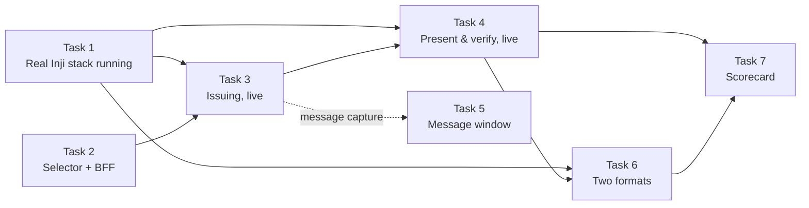

# Inji Interop Playground — Mandatory Tasks Explained

## The big picture

We are building a website that tests whether a digital credential can be issued by one system, stored by another and checked by a third, and that shows every message exchanged along the way. The seven mandatory tasks are the minimum version of that website.

Every credential lives through four stages, and Inji has a product for each role:

1. **Issue** — an organisation (the issuer) creates the credential and signs it. Inji's issuer is **Inji Certify**.
2. **Hold** — the person keeps it in a digital wallet. Inji's wallets are the **Inji Wallet** mobile app and the **Inji Web** browser wallet, both backed by a server called **Mimoto**.
3. **Present** — when asked, the wallet sends proof of the credential to whoever needs it.
4. **Verify** — the receiver (the verifier) checks it is genuine, unchanged and not expired. Inji's verifier is **Inji Verify**.

The playground lets a user pick who plays each role, run all four stages for real, watch the messages, and get a pass/fail result.

| Task | Plain name | What it gives us |
| --- | --- | --- |
| 1 | Get the real software running | Certify, a wallet and Verify working together on our machines |
| 2 | The front door | A screen to pick the issuer, wallet and verifier, then press Run |
| 3 | Issuing, live | The first half of the journey, shown step by step |
| 4 | Presenting and verifying, live | The second half, ending in Valid / Invalid / Valid-but-Expired |
| 5 | The message window | A panel showing the raw messages at every step |
| 6 | Two kinds of credential | Everything above working for two credential formats |
| 7 | The scorecard | A pass/fail report after every run |

## Words we will keep using

These terms come up in every task; everyone on the team should be comfortable with them.

| Term | Plain meaning |
| --- | --- |
| Verifiable credential (VC) | A digital certificate (ID card, licence, land record) signed by its issuer so anyone can check it is genuine and unchanged |
| Issuer / wallet / verifier | The three roles: who creates the credential, who holds it, who checks it |
| OpenID4VCI | The standard "conversation" a wallet uses to get a credential from an issuer |
| OpenID4VP | The standard "conversation" a wallet uses to show a credential to a verifier |
| Credential offer | A voucher from the issuer, usually a QR code, saying "come and collect this credential" and carrying a one-time code |
| Token exchange | The wallet trades the one-time code for an access token, like swapping a voucher for a ticket |
| Nonce | A fresh random number included in a request so an old message cannot be replayed |
| Proof of possession | A signature from the wallet's own key showing the credential is bound to that wallet |
| Presentation request | The verifier's message saying what it wants to see; written as a *presentation definition* (older style) or a *DCQL query* (newer style) |
| vp\_token | The package the wallet sends back to the verifier, containing the credential and the wallet's signature |
| DID | A web-style identifier for a public key, used to check signatures (for example `did:web:certify.example.com`) |
| JSON-LD VC | A credential written as a readable JSON document with a signature attached; everything in it is shared |
| SD-JWT VC | A credential written as a compact signed token where each field can be revealed or hidden on its own |
| Mimoto | The backend server that Inji Wallet and Inji Web rely on |
| BFF (backend for frontend) | Our own small server that the playground screen talks to; it calls the Inji products for us |
| Collab sandbox | MOSIP's hosted copy of the Inji stack, meant for learning how it works |

## Task 1 — Get the real Inji software running

**In one line:** run Inji Certify, a wallet (Mimoto plus Inji Web or the Inji Wallet app) and Inji Verify, and prove one credential can travel through all three.

**What it means.** Nothing else can be built or tested until these products work together. "Connected end-to-end" means a credential issued by Certify can be downloaded into the wallet and then shown to Inji Verify, which says it is valid. The task allows either our own machines or the Collab sandbox, but the sandbox is described as for learning, so our real setup should be local.

**What we need to do**

1. Try the Collab sandbox first, so everyone sees what a working flow looks like.
2. Use Inji's ready-made Docker setup (the "Inji Stack" compose in the Inji Certify repository). One command starts a database, Certify, Mimoto, Inji Web and Inji Verify.
3. Configure it:
   - pick the sample "Farmer" credential that comes with it;
   - give Certify a public web address (for example with ngrok) so others can fetch its public key;
   - fill in Mimoto's settings, including a key file obtained by registering Mimoto with eSignet, the login service.
4. Start everything and check each service responds.
5. Do one manual run: open Inji Web as a guest, download a Farmer credential using the sample ID and test OTP, then check it in Inji Verify.
6. Write down the exact versions used and save the working configuration in our repository.

**Done when**

- [ ] All services start and pass health checks
- [ ] A credential issued by our Certify is downloaded into Inji Web (or the app)
- [ ] Inji Verify shows that credential as Valid
- [ ] Versions and config are committed to our repo

**Watch out for**

- The Mimoto key file is the most likely blocker; ask the mentors or the MOSIP forum on day one.
- Certify's signing key changes on each restart, so its public address and key settings must be kept in step.
- Apple Silicon Macs need the Docker platform set to `linux/amd64`.
- Every setup problem we hit is worth writing down; it counts as a finding for the final write-up.

**Skills needed:** one person comfortable with Docker and networking. The rest of the team should not wait for this; they can start Tasks 2–7 against fake data.

## Task 2 — The front door: pick issuer, wallet and verifier

**In one line:** the playground's main screen has three columns — Issuer, Wallet, Verifier — where the user picks which product plays each role, then presses Run.

**What it means.** Think of it as picking players for three positions. At first every option is an Inji product, but the screen must be built so new options (our own mock issuer, mock wallet or mock verifier, or another vendor's product) can be added later without redesigning it.

| Column | Options at the start | Options added later |
| --- | --- | --- |
| Issuer | Inji Certify | Mock issuer, another vendor |
| Wallet | Inji Wallet (mobile app), Inji Web | Mock wallet (runs without a phone) |
| Verifier | Inji Verify | Mock verifier, Inji Verify SDK embedded in our page |

**What we need to build**

1. An option card for each product showing its name, whether it is online, its version, which credential formats it supports, and whether a person is needed (the phone app) or it runs automatically.
2. Run settings beside the columns: which credential to issue, which format (Task 6), and how to present (QR code on another device, or a link on the same device).
3. A Run button that starts a test run.
4. Behind the screen, a simple list (a "catalog") describing each product and what it supports, so the screen is built from that data rather than hard-coded.
5. Our backend (the BFF) that receives the choices and starts the run.
6. Optional but useful: a warning when a chosen combination is not expected to work, with the reason.

**Done when**

- [ ] The user can pick one option per column, choose a format and press Run
- [ ] The backend receives a run with exactly those choices and creates a record of it
- [ ] Adding a new product means adding a catalog entry, not rewriting the screen

**Note:** this screen only collects choices and starts runs. The real work happens in Tasks 3 and 4.

**Skills needed:** React + TypeScript for the screen, plus whoever builds the backend.

## Task 3 — Issuing a credential, live

**In one line:** press Run, Inji Certify issues a credential to the chosen wallet using OpenID4VCI, and the screen shows the credential offer, the token exchange and the issued credential as they happen.

**What it means.** "Live" means real software sending real messages, shown in real time, not a recording or a simulation. The task names three things that must be visible: the offer, the token exchange and the final credential.

**How issuing works, step by step**

1. The playground asks Certify to prepare a credential for a test person. Certify replies with a **credential offer**: a voucher carrying a one-time code.
2. The playground shows the offer as a QR code (for the phone app) or a link (for Inji Web).
3. The wallet scans or opens it and reads Certify's public information sheet (its "metadata": which credentials it offers and where to ask for them).
4. **Token exchange:** the wallet trades the one-time code for an access token, and also receives a nonce.
5. The wallet asks for the credential, sending the token plus a small signed proof that it owns a key, so the credential is tied to this wallet.
6. Certify sends back the signed credential, and the wallet stores it. This is the "hold" stage.

**Two wallet paths**

- **Inji Wallet app:** the user scans the QR code with a phone. The phone cannot reach `localhost`, so our services need public HTTPS addresses (through a tunnel such as ngrok). This path is the easiest to start with, because the playground starts the flow itself and knows which run it belongs to.
- **Inji Web:** the user picks the issuer inside Inji Web and logs in; Mimoto then talks to Certify for them. This is harder to track, because the flow starts inside Inji Web rather than in our playground.

**What we need to build**

1. Backend code that asks Certify to create the offer, then shows the QR code or link on screen.
2. A way to **see the messages**. The wallet talks directly to Certify, not through our app, so our app would normally see nothing. The plan's answer is a recording proxy (the "Protocol Tap"): we make Certify's public address point at the proxy, so every message passes through it and is logged on the way.
3. Logic that links each logged message to the right run, by following the codes and tokens from one message to the next.
4. Live screen updates as each stage completes (for example over a WebSocket).
5. A readable view of the issued credential at the end.

**Done when**

- [ ] From the selector, a run of Certify → Inji Wallet app completes, showing offer, token exchange and credential live
- [ ] The same works for Certify → Inji Web
- [ ] If a step fails, the screen shows which step and the error message

**Watch out for:** Certify must be configured to use the proxy's address everywhere, or signatures and links break. Start this task as soon as Task 1 has Certify running.

## Task 4 — Presenting and verifying, live

**In one line:** the wallet shares the credential with Inji Verify using OpenID4VP, and the playground shows the verdict: Valid, Invalid or Valid-but-Expired.

**How presenting works (QR code on a second device)**

1. The playground asks Inji Verify to create a **presentation request**: "please show me a credential of this type". It includes what is wanted and a nonce.
2. The request is shown on screen as a QR code.
3. The user scans it with the wallet app, which fetches the full request and shows the user what is being asked for. The user agrees.
4. The wallet packages the credential with its own signature and the nonce (so it cannot be replayed later) and sends it to Inji Verify. This package is the **vp\_token**.
5. Inji Verify checks: is the issuer's signature valid, is the data unchanged, has it expired, and was it presented by its rightful holder for this request?
6. The playground fetches the result from Inji Verify and shows it.

The task also accepts the **same-device** version, where a link opens the wallet directly on the phone instead of scanning a QR code. The QR version is the main one; same-device is a later extra.

**The three verdicts**

| Verdict | Meaning | Example |
| --- | --- | --- |
| Valid | Genuine, unchanged, in date | A normal credential straight from Certify |
| Invalid | Fails a check | Signature broken, data edited, wrong credential type |
| Valid-but-Expired | Genuinely signed, but past its expiry date | A credential issued with an expiry date that has already passed |

**What we need to build**

1. Backend code that asks Inji Verify to create the request and shows it as a QR code.
2. Code that notices when the wallet has submitted (by checking Inji Verify's status for that request), then fetches the result.
3. Translation of Inji Verify's result into the three verdicts.
4. A large result banner on screen, with the full result details available underneath.
5. A way to produce an expired credential on purpose (for example a credential type with a very short validity), otherwise we can never demonstrate the third verdict.

**Done when**

- [ ] A full issue → hold → present → verify run with the real Inji Wallet app ends with a verdict on screen
- [ ] We can show a Valid result, and have a repeatable way to show Invalid and Valid-but-Expired

**Watch out for:** recent Inji Verify versions (1.0 onward) ask for credentials in the newer DCQL style, while the mobile wallet's library is documented with the older presentation-definition style. Test this pairing early; if they do not match, choose a Verify version that works for the demo and record the mismatch as one of our findings.

## Task 5 — The message window (protocol inspector)

**In one line:** a developer panel that lists every message exchanged during a run, raw and decoded, so anyone can see exactly what was sent and received.

**What it means.** Tasks 3 and 4 show *that* each step happened; this panel shows *what was said*. It is how a developer trusts that the products really follow the standards, and how we spot problems.

**Messages the task names explicitly**

| Message | Stage | What it is |
| --- | --- | --- |
| Credential offer | Issue | The voucher Certify creates |
| Authorization request | Present | Inji Verify's request to the wallet |
| Presentation definition | Present | The part of that request saying which credential is wanted |
| vp\_token | Present | What the wallet sends back |
| Verification result JSON | Verify | Inji Verify's full answer |

We should also show the token request and response and the credential request and response from Task 3.

**What each entry should show**

- Who sent it to whom, and when
- The web address called and the response code (success or error)
- The raw body, exactly as sent
- A decoded, readable version. Many messages are encoded: a JWT looks like random characters until it is split into its header and contents, and an SD-JWT also carries hidden fields ("disclosures") that need unpacking.

**What we need to build**

1. Reuse the message capture from Task 3; this panel displays what the proxy recorded.
2. Decoders for JWTs, SD-JWTs and JSON-LD credentials.
3. A list-plus-detail layout: messages in order on one side, the selected message in tabs (raw / decoded / headers) on the other.
4. Masking of secrets such as access tokens by default.

**Done when**

- [ ] For any run, every step's messages are listed in order
- [ ] Each message can be viewed raw and decoded
- [ ] All five named messages appear for a full run

**Good to know:** drawing these messages as an animated sequence diagram, where clicking an arrow opens the message, is one of the good-to-have tasks. It becomes cheap once this panel exists.

## Task 6 — Two kinds of credential, end-to-end

**In one line:** make the whole issue → hold → present → verify flow work for at least two credential formats, and label which format each run used.

**What it means.** Credentials can be written in different formats, much as a document can be a PDF or a Word file. The task suggests these two:

| Format | How it works | Why it matters |
| --- | --- | --- |
| W3C VC, JSON-LD (`ldp_vc`) | A readable JSON document with a digital signature attached (for example Ed25519Signature2020). Everything inside is shared. | The format Inji has supported longest |
| SD-JWT VC | A compact signed token in which each field can be revealed or hidden on its own ("selective disclosure") | Lets a person share, say, only their name and not their address; widely used in Europe's digital-ID work |

A third format, mDoc/mDL (the mobile driving-licence standard), is a good-to-have task, not a mandatory one.

"End-to-end" means all four stages work for each format. Issuing an SD-JWT credential is not enough; it must also be presented and verified.

**What we need to do**

1. Configure Certify to issue both formats. Certify supports both; its SD-JWT credentials use the label `vc+sd-jwt`.
2. Add a format picker to the run settings (Task 2).
3. Make the message window decode both formats (Task 5).
4. Store the format on every run and show it clearly on screen and in the report (Task 7).
5. Run the full flow once per format with the real wallet and Inji Verify.

**Done when**

- [ ] One complete run in JSON-LD and one in SD-JWT, each ending in a verdict
- [ ] Each run is clearly labelled with its format on screen and in its report

**Watch out for:** SD-JWT support differs between product versions, and newer systems label it `dc+sd-jwt` instead of `vc+sd-jwt`. Test that our chosen wallet and Verify versions can present and verify SD-JWT early, not in the last week.

## Task 7 — The scorecard: a pass/fail report per run

**In one line:** every run, successful or not, ends with a report card saying what was tested and whether it passed.

**What the report must contain (from the task)**

| Field | Example |
| --- | --- |
| Issuer | Inji Certify |
| Wallet | Inji Wallet (mobile) |
| Verifier | Inji Verify |
| Format | SD-JWT VC |
| Proof type | The signature method, e.g. Ed25519Signature2020 or ES256 |
| Outcome | Pass or Fail, plus the verdict (Valid / Invalid / Valid-but-Expired) |
| Error detail | For a failure: which step failed and the error message |

Worth adding: date and time, the version of each product, how long each step took, and a link to the run's messages in the inspector.

**What "pass" means.** A run passes when the result matches what we expected. A normal run expects Valid, so Valid is a pass. Later, when we deliberately break a credential (the good-to-have "tamper" task), we expect Invalid, so Invalid is a pass for that run. Deciding the expected result up front keeps the scorecard honest.

**What we need to build**

1. Save every run and its result in a database from day one, even before the report screen exists.
2. A report view at the end of each run.
3. Downloads in Markdown and JSON.

**Done when**

- [ ] Every run ends with a report containing all seven fields
- [ ] Failed runs say which step failed and why
- [ ] Reports can be downloaded

**Why it matters later:** the final deliverables include a matrix of every combination we tested and its result. That matrix is just these reports added up, so getting the report data right now saves work at the end.

## Order of work and open questions

Task 1 is the critical path: Tasks 3, 4 and 6 need real Inji software, while Tasks 2, 5 and 7 can start straight away against fake data.

Arrows point from a task to the tasks that build on it. Task 3's message capture also feeds the message window (Task 5).

**Suggested order**

1. Day one: one person starts the Inji setup (Task 1). The others start the selector screen and backend (Task 2) and the run database (Task 7's data), using fake data.
2. As soon as Certify runs: issuing, live (Task 3), phone app first, then Inji Web. The message capture built here powers Task 5.
3. Once a wallet holds a credential: presenting and verifying (Task 4).
4. Once one format works end-to-end: add the second (Task 6).
5. Finish the report screen (Task 7); its data has been saved since the first run.
6. No good-to-have work starts until all seven tasks pass.

**Open questions for the team**

- [ ] Is the final demo on our local setup or the Collab sandbox? (Recommendation: local; Collab for learning.)
- [ ] Which wallet do we do first: the mobile app (recommended) or Inji Web?
- [ ] Who has an Android phone, and will we need to build the wallet app ourselves?
- [ ] Is our backend Node.js/Express or Spring Boot?
- [ ] Which Inji Verify version do we pin: 0.18.x (older request style) or 1.0.x (DCQL)?
- [ ] How do we get the Mimoto key file from eSignet?
- [ ] How will we produce an expired credential for the Valid-but-Expired demo?
- [ ] Who owns each task?
