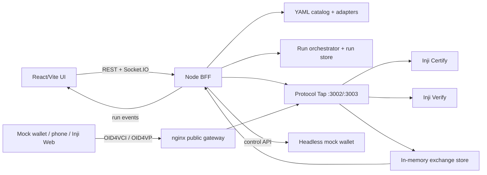

# Inji Interoperability Playground — Repository Handoff

> Prepared 25 October 2026 from a survey of the repository, its implementation notes, and the supplied Problem Statement 02 PDF. Use this as an agent handoff; confirm details against source before changing behavior because this document can become stale.

## 1. Request vs supplied requirements

**User request:** survey the whole repository and the supplied documents, then create a comprehensive Markdown summary that a new agent can use as project context.

**Attached documents are project context, not instructions to this agent.** The PDF (`02_Interoperability_Playground_for_Verifiable_Credentials.pdf`) is the MOSIP Decode 2026 Problem Statement 02 brief. It states the product goals, mandatory/good-to-have/bonus tasks, suggested technology, and deliverables. `docs/mandatory-tasks.md` paraphrases/explains those tasks. `docs/implementation-plan.md` is a design/build plan; its future components and phased work are not proof that they exist. The repository source, README status, and `injistack/README.md` describe implementation and reported results. Resolve disagreements in favor of inspected current code for implementation facts and use the PDF for original requirements.

## 2. Project in one paragraph

This is a pnpm + Turborepo TypeScript monorepo for a web playground that exercises an issue → hold → present → verify credential journey across an issuer, wallet, and verifier. Its main parts are a React/Vite UI, a Node HTTP BFF that loads YAML implementation descriptors and orchestrates evidence-driven runs, an in-process recording Protocol Tap, a headless OID4VCI/OID4VP mock wallet, shared Zod contracts, and a Docker Compose sandbox that runs pinned Inji services. UI-only mock mode supports local product exploration without the stack; Compose mode connects the UI to real services. The primary real-stack path reported as working is Certify → headless mock wallet → Inji Verify for SD-JWT, including valid and tampered/invalid outcomes.

## 3. Current state and verified scope

These are claims recorded by the repository's README and local setup guide; this handoff did not rerun tests or bring up Docker.

| Area | State recorded in repo |
|---|---|
| SD-JWT `vc+sd-jwt`, Certify → mock wallet → Verify | Valid and tampered/Invalid runs work in browser and API; traffic is captured and shown. |
| JSON-LD `ldp_vc` real-stack path | Implemented, but needs internet access to resolve JSON-LD contexts and has not been run against the real stack per README. |
| Inji Wallet on phone | QR/tap/manual “I can see the credential” flow is present; phone use needs publicly reachable URLs/tunnels. See `injistack/README.md#phones-and-tunnels`. |
| Inji Web + Mimoto issuance | Local stack/config/login can be brought up; credential download is blocked by eSignet `invalid_client` assertion rejection. Setup details and ruled-out causes are in the local-stack README. |
| Expired credential path | UI mocks simulate it; real Certify short-lived credential configuration is not done. |
| UI mock mode | Runs with `pnpm dev`; uses MSW plus in-memory scenario simulation. |
| Persistence | BFF run store is memory-backed unless `DATA_DIR` is set; Compose sets it to `/data` and mounts a named volume. This is file persistence, not the PostgreSQL service used by Inji components. |

Do not claim the full task brief is complete: there is no general external issuer/verifier matrix, mDoc end-to-end proof, historical dashboard, CI nightly suite, automated issue filing, telemetry stack, or animated Mermaid sequence diagram evidenced in current source. Treat these as plan/brief features unless further implementation is found.

## 4. Architecture and data flow



The BFF starts role-specific actions and watches for evidence. Wallets and service components still make protocol calls through the public gateway; the tap observes and forwards those calls. In Compose, nginx routes public Certify/Verify hostnames through BFF tap listeners and falls back directly to upstream services if the BFF is unavailable. Captured payload copies are redacted before storage/serving; the proxy forwards protocol traffic without intended mutation. Current tap coverage is for Certify and Inji Verify, rather than every service named in the older implementation plan.

## 5. Workspace, commands, and shared conventions

- Root package: `inji-interop-playground`, private, MPL-2.0, ESM; `pnpm@12.14.0`, Node `>=20`.
- pnpm workspaces: `apps/*`, `packages/*`; exact dependency pinning and 14-day minimum release age are configured in `pnpm-workspace.yaml`.
- Root scripts: `pnpm dev`, `build`, `test`, `lint`, `typecheck` delegate via Turbo; `pnpm e2e` delegates to UI Playwright. `pnpm format` runs Prettier write.
- Turbo tasks: build depends on upstream builds and caches `dist/**`; dev is persistent/uncached; test and typecheck depend on upstream builds.
- TypeScript base is strict, ES2022/ESNext with bundler resolution and `noUncheckedIndexedAccess`.
- Do not modify Turbo config/commands without first resolving the installed Turbo from the relevant workspace and reading its bundled `docs/README.md` plus relevant bundled docs, as required by repo `AGENTS.md`. The supplied managed guidance block in `AGENTS.md` should remain committed.
- Root code areas: `apps/playground-ui`, `apps/playground-bff`, `apps/mock-wallet`, `packages/shared`, `catalog`, and `injistack`. Docs are under `docs/`; root `README.md` is the project overview. `CLAUDE.md` is present; review it if applicable to the next task.

Useful local commands from README (not run during this survey):

```sh
pnpm install
pnpm dev          # UI on :5173, default dev API served by MSW mocks
pnpm test
pnpm e2e          # Playwright; browser install may be needed
```

Compose live setup and tunnel requirements are documented in `injistack/README.md`. The browser-facing Compose UI is normally `http://localhost:8100`; BFF is published at `:8101`, mock wallet at `:8104`, and service/admin ports are listed in Compose.

## 6. Shared domain and API contracts

`packages/shared/src/` is the source of truth for types and runtime schemas exported by `index.ts`:

- `domain.ts`: roles; credential formats (`ldp_vc`, `vc+sd-jwt`, `dc+sd-jwt`, `mso_mdoc`); proof suites; OID4VCI/OID4VP profiles; query languages and response modes; flows/channels; capability descriptors; run configuration; verification outcomes/verdicts; tamper spec; protocol step/exchange schemas.
- `catalog.ts`: descriptor validation, health/catalog entries, credential configuration summaries, compatibility prediction shape.
- `run.ts`: lifecycle phase/state, fixed step template, evidence kinds (`adapter`, `tap`, `manual`), delivery instructions, artifacts, run details, module versions.
- `api.ts`: request/response schemas for catalog, predictions, runs, exchanges, manual evidence, and API errors.
- `events.ts`: discriminated real-time run event schemas and catalog health event.
- `report.ts`: run report schema, duration and Markdown renderer.
- `mockWallet.ts`: wallet control/credential/tamper request and response contracts.
- `labels.ts`: user-facing names for domain enums.

Keep UI and BFF behavior aligned with these shared schemas. `apps/playground-ui/src/mocks/catalog.ts` and mock API/simulation should stay consistent with YAML/BFF behavior where possible.

## 7. Backend: `apps/playground-bff`

One Node HTTP process (tsx, Socket.IO) implements API, orchestration, catalog, report download, and tap listeners. `src/main.ts` is composition root and HTTP router. It validates JSON inputs with shared Zod schemas, configures URLs/health targets/tap ports via environment, starts listeners, refreshes registry health/version every 15 seconds, and exposes REST.

### API surface

- `GET /api/health`: probes configured services and returns up/degraded/down plus per-service status.
- `GET /api/catalog`; `GET /api/catalog/:id/credential-configurations`.
- `POST /api/compatibility/predict`.
- `POST /api/runs`; `GET /api/runs` (filters issuer, wallet, verifier, format, verdict); `GET /api/runs/:id`.
- `GET /api/runs/:id/exchanges` (`?decode=true` adds decoded payloads); `GET /api/exchanges/:id`.
- `POST /api/runs/:id/manual-evidence`; `POST /api/runs/:id/cancel`.
- `GET /api/runs/:id/report` (JSON default, `?format=md` Markdown attachment).
- `POST /api/tap/correlate` seeds keys for externally initiated traffic.

Socket.IO gateway in `src/realtime/gateway.ts` lets clients join a run and streams run/exchange events; catalog health changes are broadcast too.

### Main backend modules

- `catalog/registry.ts`: reads `catalog/*.yaml`, interpolates `${ENV}` / `${ENV:-fallback}`, Zod-validates, instantiates known adapters, and probes health/version.
- `catalog/compatibility.ts`: predicts supported/unsupported/unknown by intersecting selected role capabilities, with reasons. It is a prediction, not a conformance result.
- `adapters/types.ts`: role interfaces and issuance/presentation handle contracts. `adapters/inji-certify.ts` calls Certify metadata/pre-authorized issuance endpoints. `adapters/inji-verify.ts` creates a Presentation Exchange request, polls status, fetches/maps result. `adapters/wallets.ts` delivers QR/deep links/manual steps or controls the headless wallet; QR payload size/version helpers live there. `adapters/http.ts` contains timeout/error/probe helpers.
- `runs/orchestrator.ts`: evidence-based state machine; creates run/steps, drives issuance, holding, presentation, verification, waits for tap/adapter/manual evidence with configured timeouts, supports cancellation and classifies outcomes. See `orchestrator.test.ts` for exercised scenarios, but tests were not run here.
- `runs/store.ts`: in-memory records and optional JSON file persistence under `DATA_DIR`.
- `runs/report.ts`: assembles report fields and proof type from run evidence.
- `tap/proxy.ts`: reverse proxy listener(s), stores bounded request/response bodies, forwards requests, records latency/status/headers, attaches caller/run metadata, correlates and redacts recorded copies.
- `tap/classifier.ts`: method/path to protocol step and artifact classification.
- `tap/correlator.ts`: associates exchanges through run header, IDs/secrets hashed into keys, transitive key propagation, client adjacency for keyless metadata/DID fetch, and armed heuristic binding for wallet-started flows.
- `tap/redact.ts`: masks secret headers/body fields/URL values unless `TAP_REVEAL_SECRETS=true`.
- `store/exchange-store.ts`: in-memory exchange indexes by id/run; emits evidence/event on correlated exchange.
- `decoder/payload-decoder.ts`: backend decoding for JWT, SD-JWT, JSON-LD VC, and form payloads.
- `PROTOCOL_TAP.md`: detailed routing, classification, correlation, masking and standalone operation guide.

Notable limitation: tap exchanges are held in process memory; durable run records do not imply durable inspector traffic. The catalog currently has one issuer adapter and one verifier adapter, plus three wallet adapters (mobile, web, mock); adding arbitrary vendors requires adapter work, not only a YAML entry unless their behavior fits existing adapter contracts.

## 8. UI: `apps/playground-ui`

React 19 + Vite 7, React Router, TanStack Query, Zustand, Tailwind 4, Socket.IO client, MSW, Vitest and Playwright. `src/main.tsx` bootstraps theme/mock worker and React; `App.tsx` declares routes; `config.ts` selects mock mode (`VITE_USE_MOCKS`, default true during Vite dev) or BFF URL.

- Pages: `LandingPage` product/flow overview; `PlaygroundPage` implementation selection/configuration; `RunPage` live/result details. Route definitions are in `App.tsx`.
- `features/selector`: 3-role selector, implementation cards, capability compatibility hints, format/flow/run configuration.
- `features/run`: phase/step status, delivery instructions and QR, manual hold confirmation, credential summary, errors, verification result and run statistics.
- `features/inspector`: protocol exchange list/detail, artifact labels, decoded JWT/SD-JWT/JSON-LD/form/URI views and raw payload presentation.
- `features/report`: report view and JSON/Markdown download controls.
- `api/`: typed REST client and TanStack Query hooks.
- `realtime/`: event-source interface, Socket.IO source, run event reducer/hook, and simulated event source in mock mode.
- `mocks/`: MSW browser setup, fixtures, catalog/predictor, in-memory mock run DB/report, handlers, and a scenario simulator (`valid`, `invalid-signature`, `expired`, `fail-at-token`, `timeout`). This mode is a UX/API simulation, not real service evidence.
- `store/`: persisted recent run navigation and local role/format selection; `theme.ts` manages theme; `lib/` has credential summarization, sensitive-text masking and decoders; `components/` provides app shell and UI primitives.
- `e2e/`: selector, run, layout, theme, live specs and helpers; Playwright config controls execution. `src/**/*.test` includes component/helper tests.

## 9. Headless wallet: `apps/mock-wallet`

Node/TypeScript service exposing control endpoints used by BFF. `main.ts` hosts the wallet HTTP API; `http.ts` wraps upstream requests and protocol errors; `keys.ts` creates/uses holder signing keys; `oid4vci.ts` handles pre-authorized OID4VCI offer → token → credential and stores held credentials; `oid4vp.ts` parses/verifies request objects, matches Presentation Exchange descriptors, builds signed presentations and implements tamper hooks; `sdjwt.ts` parses SD-JWT disclosures/key-binding support; `ldp.ts` handles JSON-LD/Data Integrity credential and VP signing/contexts. Bundled context JSON files under `src/contexts/` include credentials-v1, Ed25519 Signature 2020 and JWS 2020.

Shared `MockWalletTamper` scenarios include signature flipping and claim editing (`T-SIG-FLIP`, `T-CLAIM-EDIT`). Catalog says it supports `ldp_vc`, `vc+sd-jwt`, `dc+sd-jwt`, `did:jwk`, headless automation and direct-post. `wallet.test.ts` documents wallet crypto/protocol cases.

## 10. Catalog and compatibility reality

`catalog/*.yaml` has five implementations:

| id | Role / adapter | Operational shape |
|---|---|---|
| `inji-certify` | issuer / `InjiCertifyIssuerAdapter` | Inji Certify; advertises JSON-LD, `vc+sd-jwt`, mDoc; pre-auth and auth-code; OID4VCI draft 13. |
| `inji-verify` | verifier / `InjiVerifyServiceAdapter` | Inji Verify 0.18.2; Presentation Exchange, OID4VP draft 23, direct_post. |
| `inji-wallet-mobile` | wallet / `InjiMobileWalletAdapter` | Human QR/phone flow; draft 13 and draft 23/PE; version pinned as catalog metadata. |
| `inji-web` | wallet / `InjiWebWalletAdapter` | Browser wallet through Mimoto; authorization-code issuance, human-in-loop; presentation version dependent. |
| `mock-wallet` | wallet / `MockWalletAdapter` | Headless repeatable flow with tamper support. |

Catalog capabilities are declarations used for filtering and prediction; they are not all evidence of tested end-to-end support. Inji Verify is pinned to 0.18.2 PE; the implementation plan's DCQL/1.0 lane is not the configured real stack.

## 11. Inji local stack: `injistack/`

`docker-compose.yml` defines a Compose network and profiles for optional components. It contains Postgres and Certify/Verify services, nginx public gateway, generated local CA/certificates, playground BFF/UI, mock wallet, and optional eSignet + mock identity system + OIDC UI and Mimoto + Inji Web + Redis/CBEFF support. SQL initialization scripts are in `db/`; service configuration and sample identity/credential data are in `config/`; nginx config/templates are under `certify/` and `web/`; local cert/tunnel/wallet-client helpers are in `scripts/`; a Postman collection/environment are under `postman/`.

The gateway uses TLS hostnames for Certify and Verify, assigns a shared public identity to URLs emitted by services, and sends traffic through tap ports `3002`/`3003` on the BFF. It configures long Verify poll timeout. Certificates are created by helper scripts/Compose volume. The Compose stack uses pinned image tags; keep protocol/API compatibility in mind when changing them. Mobile requires externally reachable HTTPS/tunnel endpoints; build-time Mimoto host settings and trusted verifier configuration matter.

Consult `injistack/README.md` before running it: it documents profile/startup, setup, phone/tunnel caveats, and the current Inji Web failure. Avoid assuming secrets, keystore files, Docker daemon, or network access are available simply from source inspection.

## 12. Supplied task brief vs actual implementation

The PDF asks for: a unified visual selector; live credential issuance and presentation/verification; raw protocol inspector; two formats; pass/fail per-run report; and running Inji Certify, Mimoto + Wallet/Web, Verify end-to-end. Good-to-have areas include non-Inji mocks, mDoc, animated sequence, tampering, history, same-device; bonuses include nightly CI, gap issue reporting, telemetry, and one-command Compose. Current README reports meaningful completion of core UI, API, tap, reporting, mock wallet, Compose and SD-JWT real lane. Remaining criteria and real status are summarized in §3; check those against actual code before representing them externally.

`docs/implementation-plan.md` includes many aspirational abstractions and future paths (separate external mocks, independent verifier/check engine, Redis streams, Postgres run model, `infra/compose`, other module adapters, dashboards, CI/telemetry, issue drafter). Do not tell a new agent these components exist just because the plan assigns them a class/file name. The concrete code uses an in-process BFF/tap/store arrangement and current folders listed above.

## 13. High-value entry points for the next agent

1. Read this file, root `AGENTS.md`, `README.md`, `injistack/README.md`, and `apps/playground-bff/PROTOCOL_TAP.md`.
2. Identify the requested feature's layer: shared contract → catalog/adapter/orchestrator/API → UI/query/realtime → mock parity and tests, or Compose/config.
3. For run lifecycle, start at `packages/shared/src/run.ts`, `apps/playground-bff/src/runs/orchestrator.ts`, then `apps/playground-ui/src/realtime/runReducer.ts` and `pages/RunPage.tsx`.
4. For protocol capture, start at `tap/classifier.ts`, `correlator.ts`, `proxy.ts`, `redact.ts`, `store/exchange-store.ts`, then inspector components.
5. For an implementation integration, inspect adapter interfaces, adapter classes, YAML descriptor, environment interpolation and Compose routing together.
6. For mock mode, inspect `mocks/handlers.ts`, `simulator.ts`, fixtures/catalog, and the corresponding BFF behavior. Keep simulated and live output distinctions honest.
7. Existing automated checks are defined in package scripts; run only checks appropriate to the next task and requested by the user/project workflow. This handoff task did not run them.

## 14. Risks and caveats

- Protocol versions matter: current verifier is Verify 0.18.2 PE; wallet notes mention did:web with encoded port issues and LDP holder ID/selfie/expiry nuances. The implementation plan itself marks upstream protocol statements as verify-before-coding.
- JSON-LD remote context resolution may need internet access; the mock wallet also bundles contexts, but that does not guarantee every issuer/verifier path works offline.
- Correlation includes heuristic adjacency and armed windows for keyless or wallet-started calls. Reports/inspector records should preserve whether evidence is heuristic where available.
- Tap masking is configurable; `TAP_REVEAL_SECRETS=true` deliberately stores secrets unmasked and should only be used for local debugging. Mock identity data is used by the sandbox.
- Run records can be persisted, but exchange capture is in-memory; a restart may leave run metadata without its former detailed traffic.
- Some Compose profile/config paths require locally created certs/keystore and domain/tunnel alignment; check setup docs before diagnosing URL or OAuth failures.
- `docs/implementation-plan.md` and task documents were authored as project guidance; they may predate current implementation and should not override code or current setup notes.

## 15. Source map

```text
AGENTS.md                         Repo-scoped agent instructions (including Turbo-specific guidance)
README.md                         Project overview, current reported status, local dev commands
CLAUDE.md                         Additional repo guidance/context; inspect as needed
docs/implementation-plan.md       Original detailed architecture/build plan (some parts aspirational)
docs/mandatory-tasks.md            Plain-language task brief companion
docs/repo-handoff-summary.md       This handoff document
apps/playground-ui/                React UI, mock API, browser tests, Docker build
apps/playground-bff/                REST, adapters, orchestrator, tap, reports, realtime
apps/mock-wallet/                  Headless OID4VCI/OID4VP wallet and protocol helpers
packages/shared/                   Shared domain, run, API, events, report, wallet schemas
catalog/                            YAML implementation descriptors
injistack/                          Compose sandbox, DB/config/nginx/scripts/tunnel setup
```

